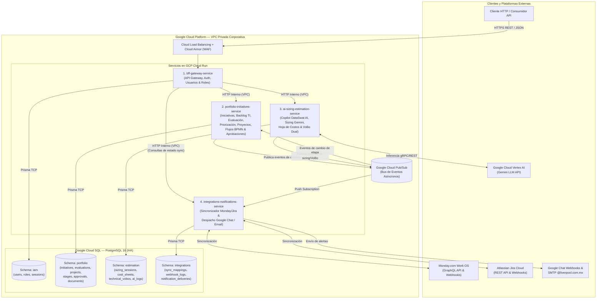
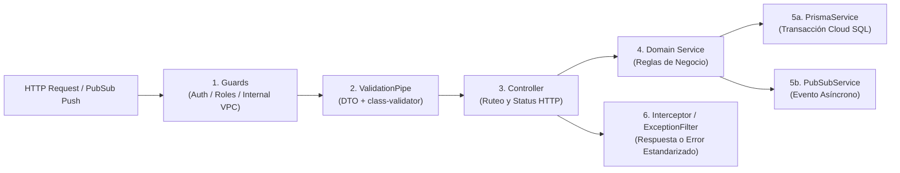
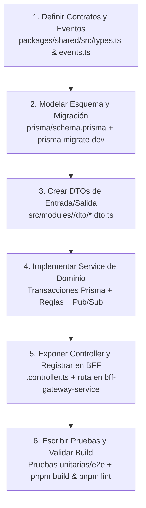

# Lineamientos de Desarrollo Backend — DevCycle (El Puerto de Liverpool)

**Documento Oficial de Arquitectura de Microservicios, Estándares Técnicos y Convenciones de Código**  
**Proyecto:** DevCycle — Gestión Integral del Portafolio de Iniciativas (`apps/backend` y ecosistema de microservicios)  
**Organización:** El Puerto de Liverpool (Infraestructura en Google Cloud Platform — Cloud Run & Cloud SQL)  
**Última actualización:** Noviembre 2026

---

## Tabla de Contenidos

1. [Introducción](#1-introducción)
2. [Principios de Arquitectura y Catálogo de Microservicios](#2-principios-de-arquitectura-y-catálogo-de-microservicios)
3. [Stack Tecnológico](#3-stack-tecnológico)
4. [Estructura del Proyecto](#4-estructura-del-proyecto)
5. [Reglas Generales de Organización de Código](#5-reglas-generales-de-organización-de-código)
6. [Lineamientos de Desarrollo](#6-lineamientos-de-desarrollo)
7. [Cómo Crear un Nuevo Módulo, Endpoint o Microservicio](#7-cómo-crear-un-nuevo-módulo-endpoint-o-microservicio)
8. [Performance, Escalabilidad y Optimización en GCP](#8-performance-escalabilidad-y-optimización-en-gcp)
9. [Seguridad y Resiliencia](#9-seguridad-y-resiliencia)
10. [Definition of Done (DoD)](#10-definition-of-done-dod)
11. [Proceso de Trabajo (Git y Convenciones de Commits)](#11-proceso-de-trabajo-git-y-convenciones-de-commits)

---

## 1. INTRODUCCIÓN

### 1.1 Contexto de la Plataforma y Rol del Backend

**DevCycle** es la plataforma corporativa de **El Puerto de Liverpool** destinada a unificar, automatizar y gobernar de extremo a extremo el ciclo de vida del portafolio de iniciativas tecnológicas a través de **4 etapas macro** (*1. Definición*, *2. Estimación*, *3. Ejecución* y *4. Cierre*).

El **Backend de DevCycle** constituye el núcleo transaccional, de inteligencia artificial y de integración empresarial de la solución. Su responsabilidad es garantizar la persistencia ACID, el cumplimiento de las reglas de negocio y gobierno (aprobaciones por rol, cálculo oficial de puntajes, desplazamientos de prioridad y doble VoBo técnico), la orquestación de modelos generativos en **Google Cloud Vertex AI (Gemini)** y la sincronización asíncrona con el ecosistema corporativo (**Monday.com**, **Jira Cloud**, **Google Chat** y correo institucional `@liverpool.com.mx`).

Toda la plataforma backend está diseñada para ejecutarse bajo una **arquitectura de microservicios contenerizados en Google Cloud Run**, respaldada por una base de datos relacional **PostgreSQL 16 en Google Cloud SQL** y mensajería asíncrona mediante **Google Cloud Pub/Sub**.

### 1.2 Diagnóstico del Estado Actual del Backend

Durante la primera iteración del proyecto, el esfuerzo de ingeniería se concentró prioritariamente en la experiencia funcional de los flujos de negocio, dejando en `apps/backend` una implementación preliminar de referencia con las siguientes características:

1. **Almacenamiento volátil en memoria:** Los controladores actuales (`ProjectsController`, `FlowsController`, `UsersController`, `AssistantController`) operan sobre copias mutables en memoria importadas desde `@devcycle/shared` (`seedProjects`, `stages`, `roles`, `users`), perdiendo cualquier cambio al reiniciar el contenedor.
2. **Cobertura parcial del dominio:** Gran parte del ciclo de vida evolucionado de las iniciativas (registro extendido de *Discovery & Intake*, filtro obligatorio de *Backlog TI*, evaluación multicriterio con *Pirámide Estratégica* + *Pizza OKRs* + *5 Criterios*, reordenamiento con control de desplazamientos, *Sizing* con IA, *Hoja de Costos* y *VoBo Dual* de Líder Técnico y Arquitectura) aún no cuenta con endpoints ni persistencia en el backend.
3. **Respuestas simuladas de IA:** El módulo `assistant` actual responde mediante coincidencia estática de palabras clave (`KEYWORD_RESPONSES`), sin conexión real con Vertex AI / Gemini ni persistencia de sesiones conversacionales.
4. **Ausencia de validación estricta, autenticación y capa de eventos:** Los DTOs actuales son interfaces planas de TypeScript sin validación en tiempo de ejecución (`ValidationPipe`), sin guards de identidad/roles ni publicación de eventos hacia sistemas externos.

El presente documento establece la **arquitectura objetivo de microservicios y los estándares obligatorios** para construir y evolucionar el backend productivo de DevCycle sobre bases sólidas, escalables y mantenibles.

### 1.3 Objetivo del Documento

Definir los **lineamientos técnicos, arquitectónicos, de diseño de microservicios, persistencia y programación** que deben seguirse de manera **obligatoria** en todo desarrollo backend de **DevCycle**.

Estos lineamientos buscan garantizar:

- **Delimitación clara de microservicios (grano medio):** Evitar tanto el monolito rígido como la fragmentación excesiva (*nano-servicios*), agrupando capacidades altamente cohesivas en servicios bien definidos sobre **GCP Cloud Run**.
- **Integridad transaccional y consistencia de datos:** Uso estandarizado de **PostgreSQL en Cloud SQL** con aislamiento por esquemas lógicos y transacciones ACID.
- **Calidad, seguridad y mantenibilidad del código:** Estandarización sobre **NestJS**, **TypeScript estricto**, **Prisma ORM** y contratos compartidos en `@devcycle/shared`.
- **Comunicación predecible y desacoplada:** Reglas claras para llamadas síncronas internas (HTTP/REST sobre VPC) y eventos asíncronos (**Google Cloud Pub/Sub**).

### 1.4 Alcance

Los lineamientos descritos en este documento aplican exclusivamente al desarrollo del **backend de DevCycle** (todos sus microservicios en NestJS) y a la definición de contratos, DTOs y eventos en el paquete compartido **`packages/shared` (`@devcycle/shared`)**.

Este documento cubre:

- Catálogo oficial de microservicios, sus límites de dominio (*Bounded Contexts*), nombres y responsabilidades.
- Patrones de comunicación síncrona y asíncrona entre servicios.
- Diseño de base de datos en Cloud SQL PostgreSQL y convenciones de Prisma ORM.
- Estructura de carpetas, arquitectura en capas por módulo y estándares de código en NestJS.
- Validación de DTOs, manejo de errores, observabilidad, seguridad, rendimiento, Definition of Done (DoD) y flujo de trabajo en Git.

### 1.5 Responsabilidades del Equipo de Desarrollo y Agentes de IA

Todo desarrollador backend o agente de IA que implemente un microservicio, módulo, endpoint, migración de base de datos o integración en el repositorio deberá apegarse estrictamente a este documento:

- Respetar los límites de responsabilidad de cada microservicio sin mezclar dominios ni crear dependencias circulares entre servicios.
- Garantizar que toda entrada externa sea validada con DTOs y `class-validator`, que las operaciones críticas sean transaccionales y que el código compile sin errores de TypeScript ni de linting.
- Consultar con el Líder Técnico / Arquitecto Backend ante cualquier necesidad de modificar el catálogo de microservicios, esquemas de base de datos o dependencias globales.

### 1.6 Consideraciones sobre Código Existente (`apps/backend`)

Los módulos iniciales en memoria dentro de `apps/backend/src/` (`flows`, `projects`, `users`, `assistant`) constituyen un *scaffolding* de prototipo:

- El uso de arreglos en memoria (`JSON.parse(JSON.stringify(seedProjects))`) o DTOs declarados solo como `interface` **no debe replicarse** en ningún desarrollo nuevo.
- **Todo nuevo endpoint, módulo o microservicio debe implementarse siguiendo al 100% los lineamientos de este documento** (clases DTO validadas, persistencia en PostgreSQL vía Prisma, manejo de excepciones tipado y pruebas).

---

## 2. PRINCIPIOS DE ARQUITECTURA Y CATÁLOGO DE MICROSERVICIOS

### 2.1 Racional de Consolidación de Dominios (Arquitectura de Grano Medio)

Para que la arquitectura de microservicios de DevCycle sea **operativamente eficiente, económica en Cloud Run y fácil de mantener**, se adopta el principio de **Microservicios de Grano Medio orientados a Dominios Cohesivos (*Bounded Contexts*)**, evitando explícitamente una arquitectura hiper-atómica (*nano-servicios*).

Al analizar de extremo a extremo todas las capacidades requeridas por la aplicación, se identifican relaciones estrechas donde **unificar dominios afines en un mismo microservicio es técnicamente superior a separarlos**:

1. **Unificación de Identidad, Usuarios/Roles y API Gateway (`bff-gateway-service`):**
   - El catálogo de usuarios (`users`), roles (`roles`) y validación de contexto corporativo (SSO Liverpool y sesión de Monday) se consulta en prácticamente cada petición para validar permisos y *gating* de aprobaciones. Mantener la gestión de identidad, usuarios y roles dentro del mismo servicio que actúa como **BFF / API Gateway** evita un salto de red adicional en cada petición autenticada.
2. **Unificación de Iniciativas, Backlog TI, Evaluación, Priorización, Proyectos y Flujos BPMN (`portfolio-initiatives-service`):**
   - En el dominio de DevCycle, una **Iniciativa** que nace en *Discovery*, pasa por *Backlog TI*, se evalúa (*Pirámide + Pizza OKRs + 5 Criterios*), se prioriza en el comité y avanza a *Ejecución* **es la misma entidad de negocio** que el **Proyecto / Charter** con sus etapas macro, subpasos BPMN (`flows`), documentos adjuntos (`files`), número PEP y aprobaciones (`approvals`).
   - Separar "Iniciativas/Priorización" de "Proyectos/Flujos BPMN" obligaría a realizar transacciones distribuidas complejas para mantener sincronizados estados, etapas y aprobaciones. Por ello, **todo el ciclo de vida core del portafolio vive en un único microservicio transaccional**.
3. **Unificación de Asistente Conversacional (Copilot/DataSwat AI), Sizing con Gemini, Hoja de Costos y VoBo Dual (`ai-sizing-estimation-service`):**
   - Tanto el asistente inteligente de portafolio/Discovery (extracción de datos de documentos, sugerencias de alcance/OKRs y chat contextual) como el agente conversacional de dimensionamiento técnico (cálculo de TPS, concurrencia, SLA, servicios GCP y horas de desarrollo) utilizan el mismo motor de inferencia (**Google Cloud Vertex AI / Gemini**) y comparten el contexto técnico de la iniciativa.
   - Asimismo, la **Hoja de Costos** y el **VoBo Dual** (Líder Técnico + Líder de Arquitectura) son el resultado directo del dimensionamiento de IA. Agruparlos en un solo microservicio centraliza toda la lógica de ingeniería de prompts, control de tokens, tarifas de cómputo/horas y dictamen técnico.
4. **Unificación de Sincronización Externa (Monday/Jira) y Notificaciones (Google Chat/Email) (`integrations-notifications-service`):**
   - Tanto la sincronización bidireccional con **Monday.com** y **Jira Cloud** como el despacho de alertas por **Google Chat** y **Correo electrónico** son adaptadores de salida (*Outbound Integrations*) que se disparan de forma asíncrona ante los mismos eventos de negocio publicados en **Google Cloud Pub/Sub** (p. ej. iniciativa registrada, prioridades formalizadas, VoBo completado).
   - Consolidarlos en un único microservicio orientado a eventos reduce a la mitad la infraestructura de workers asíncronos, centraliza el manejo de reintentos (*retries*), *rate limits* de APIs de terceros y bitácoras de entrega.

---

### 2.2 Catálogo Oficial de Microservicios (4 Microservicios en GCP Cloud Run)

El backend de DevCycle se compone exactamente de **4 microservicios independientes**, cada uno desplegado como un servicio contenedorizado en **Google Cloud Run**:



#### Resumen de los 4 Microservicios

| # | Nombre del Microservicio (Cloud Run) | Dominios que Unifica | Responsabilidades Principales | Prefijos de Ruta Expuestos | Esquema en PostgreSQL |
| :-: | :--- | :--- | :--- | :--- | :--- |
| **1** | **`bff-gateway-service`** | • API Gateway / BFF<br>• Autenticación y Contexto Monday<br>• Usuarios y Roles (`users`, `roles`) | • Único punto de entrada público (Ingress externo).<br>• Validación de JWT corporativo, token de sesión de Monday y simulación controlada de roles.<br>• CRUD y consulta del catálogo de usuarios y roles corporativos.<br>• Rate limiting, validación de cabeceras, inyección de `x-correlation-id` y enrutamiento HTTP interno hacia los microservicios de dominio. | `/api/v1/auth/*`<br>`/api/v1/users/*`<br>`/api/v1/roles/*`<br>*(Proxy hacia `/initiatives`, `/projects`, `/flows`, `/estimation`, `/assistant`, `/integrations`)* | `iam` |
| **2** | **`portfolio-initiatives-service`** | • Discovery & Intake<br>• Cartera de Pendientes (Backlog TI)<br>• Evaluación Multicriterio (Pirámide + Pizza + 5 Criterios)<br>• Priorización y Comité<br>• Proyectos, Flujos BPMN, Documentos y Aprobaciones | • Registro integral de iniciativas desde Discovery (alcance, OKRs, ROI, capacidades, dependencias).<br>• Validación mandatoria de impacto TI y confirmación de sistemas Liverpool afectados.<br>• Motor de cálculo y persistencia de Evaluación Multicriterio (Score 0–100) y dictamen formal.<br>• Reordenamiento transaccional de prioridades con cálculo atómico de desplazamientos y formalización de portafolio.<br>• Gestión de las 4 etapas macro, subpasos BPMN (`flows`), proyectos/Charters, folios PEP, metadatos de documentos y compuertas de aprobación por rol (`approvals`). | `/api/v1/initiatives/*`<br>`/api/v1/portfolio/*`<br>`/api/v1/projects/*`<br>`/api/v1/flows/*` | `portfolio` |
| **3** | **`ai-sizing-estimation-service`** | • Asistente Conversacional DataSwat AI / Copilot<br>• Dimensionamiento Técnico con Gemini (Sizing)<br>• Motor de Hoja de Costos<br>• Workflow de Doble VoBo Técnico | • Integración con **Google Cloud Vertex AI (Gemini)** para asistencia en Discovery (análisis de documentos, generación de sugerencias de alcance/beneficios) y chat contextual de portafolio.<br>• Conversación guiada de dimensionamiento técnico (captura de TPS pico, usuarios mensuales, SLA y arquitectura).<br>• Cálculo automatizado de la **Hoja de Costos** (horas de desarrollo por disciplina en MXN y costos mensuales de nube GCP en USD).<br>• Gestión del **VoBo Dual** simultáneo (`Líder Técnico` y `Líder de Arquitectura`), registro de observaciones de refinamiento y emisión del evento de pase a Ejecución. | `/api/v1/estimation/*`<br>`/api/v1/assistant/*` | `estimation` |
| **4** | **`integrations-notifications-service`** | • Sincronizador Monday.com & Jira Cloud<br>• Recepción de Webhooks Externos<br>• Servicio de Notificaciones (Google Chat & Correo) | • Suscripción asíncrona a los tópicos de **Google Cloud Pub/Sub**.<br>• Sincronización bidireccional de iniciativas aprobadas hacia tableros ejecutivos de **Monday.com** (GraphQL API) y creación/seguimiento de épicas en **Jira Cloud** (REST API).<br>• Despacho de alertas transaccionales y resúmenes de comité hacia espacios de **Google Chat** (Webhooks) y correos `@liverpool.com.mx` (plantillas institucionales).<br>• Registro de trazabilidad de sincronizaciones y bitácora de notificaciones enviadas. | `/api/v1/integrations/*`<br>`/api/v1/webhooks/*`<br>`/api/v1/notifications/*` | `integrations` |

---

### 2.3 Arquitectura de Comunicación entre Microservicios

Los microservicios de DevCycle se comunican bajo un modelo híbrido **Síncrono (HTTP/REST interno)** para consultas y comandos inmediatos, y **Asíncrono (Event-Driven con Google Cloud Pub/Sub)** para efectos secundarios, integraciones y desacoplamiento entre dominios:

#### 2.3.1 Comunicación Síncrona (Request / Response)
1. **Cliente Externo ➔ `bff-gateway-service`:**
   - Único canal expuesto hacia el exterior a través de **Cloud Load Balancing** con HTTPS/TLS.
2. **`bff-gateway-service` ➔ Microservicios Internos (`portfolio-initiatives-service`, `ai-sizing-estimation-service`, `integrations-notifications-service`):**
   - Comunicación mediante **HTTP/REST con JSON** viajando exclusivamente por la red privada (**Serverless VPC Access**) de GCP.
   - Los microservicios internos se configuran en Cloud Run con `ingress: internal`, rechazando cualquier tráfico directo desde Internet.
   - El Gateway propaga en cada llamada interna las cabeceras estandarizadas de contexto:
     - `x-correlation-id`: UUID único de trazabilidad de la petición.
     - `x-user-id`: Identificador del usuario autenticado (o simulado en entornos no productivos).
     - `x-user-role`: Rol efectivo validado por el Gateway.
     - `x-monday-account-id`: Identificador de cuenta de Monday cuando aplica.
3. **Regla de No Encadenamiento Síncrono entre Microservicios de Dominio:**
   - Los microservicios de dominio (`portfolio-initiatives-service`, `ai-sizing-estimation-service`, `integrations-notifications-service`) **no deben realizar cadenas de llamadas HTTP síncronas entre sí** para mutar estado. Toda coordinación cruzada tras una escritura debe realizarse mediante eventos en **Google Cloud Pub/Sub**.

#### 2.3.2 Comunicación Asíncrona (Event-Driven con Google Cloud Pub/Sub)
Las operaciones que involucran a otros microservicios o sistemas externos se comunican publicando eventos de dominio en **Google Cloud Pub/Sub** y entregándolos mediante **Push Subscriptions autenticadas con OIDC** hacia los endpoints internos de los consumidores en Cloud Run:

| Tópico en Cloud Pub/Sub | Evento (`eventType`) | Publicador | Consumidor(es) | Acción Disparada |
| :--- | :--- | :--- | :--- | :--- |
| `devcycle.initiatives.events` | `initiative.created` | `portfolio-initiatives-service` | `integrations-notifications-service` | Notifica por correo/Google Chat a PMO y Arquitectura sobre una nueva iniciativa pendiente de validación en Backlog TI. |
| `devcycle.initiatives.events` | `initiative.ti_validated` | `portfolio-initiatives-service` | `integrations-notifications-service` | Notifica al Portfolio Manager que la iniciativa fue confirmada con impacto TI (o descartada). |
| `devcycle.initiatives.events` | `initiative.evaluated` | `portfolio-initiatives-service` | `integrations-notifications-service` | Registra auditoría de evaluación y actualiza indicadores en Monday.com si la iniciativa ya está vinculada. |
| `devcycle.portfolio.events` | `portfolio.priorities_formalized` | `portfolio-initiatives-service` | `integrations-notifications-service` | Congela el orden en el tablero directivo de Monday.com y envía alerta masiva de acuerdos de comité y desplazamientos a Google Chat y sponsors. |
| `devcycle.estimation.events` | `estimation.cost_sheet_updated` | `ai-sizing-estimation-service` | `portfolio-initiatives-service` | Sincroniza el resumen financiero (horas estimadas y costo mensual de nube) en la ficha de la iniciativa. |
| `devcycle.estimation.events` | `estimation.vobo_recorded` | `ai-sizing-estimation-service` | `portfolio-initiatives-service`, `integrations-notifications-service` | Si es solicitud de refinamiento, cambia estatus a `"Con comentarios"` y notifica al BP. Si ambos VoBos (`tecnico` y `arquitectura`) están aprobados, avanza la iniciativa a etapa **Ejecución**, genera el Charter y crea la épica en **Jira Cloud**. |

---

### 2.4 Arquitectura de Persistencia en Cloud SQL (PostgreSQL 16)

El sistema utiliza una instancia administrada de **Google Cloud SQL for PostgreSQL 16** (configurada en Alta Disponibilidad Multi-Zona dentro de la VPC privada).

Para mantener el aislamiento de datos propio de los microservicios sin incurrir en el sobrecosto operativo y económico de pagar 4 instancias separadas de Cloud SQL, se establece el patrón de **Instancia Compartida con Aislamiento Estricto por Esquema Lógico (`PostgreSQL Schemas`)**:

1. **Un esquema por microservicio:**
   - `iam`: Tablas exclusivas de `bff-gateway-service` (`users`, `roles`, `permissions`, `sessions`).
   - `portfolio`: Tablas exclusivas de `portfolio-initiatives-service` (`initiatives`, `initiative_okrs`, `initiative_dependencies`, `initiative_evaluations`, `priority_history`, `projects`, `stages`, `substeps`, `project_documents`, `approvals`).
   - `estimation`: Tablas exclusivas de `ai-sizing-estimation-service` (`sizing_conversations`, `sizing_messages`, `cost_sheets`, `technical_vobos`, `ai_usage_logs`).
   - `integrations`: Tablas exclusivas de `integrations-notifications-service` (`external_sync_links`, `sync_execution_logs`, `notification_logs`, `processed_events`).
2. **Prohibición de consultas cruzadas entre esquemas:**
   - Ningún microservicio puede ejecutar `JOIN` ni `SELECT/UPDATE` sobre tablas pertenecientes al esquema de otro microservicio.
   - Cada microservicio posee su propio usuario de base de datos con permisos `GRANT` restringidos únicamente a su esquema asignado y su propio archivo `prisma/schema.prisma`.
   - Las referencias entre microservicios se almacenan como identificadores lógicos (p. ej. `initiative_id: UUID`, `user_id: VARCHAR`) sin *Foreign Keys* físicas entre esquemas distintos.

---

### 2.5 Principios de Diseño Interno

1. **Separación en Capas por Módulo:** Cada módulo de negocio dentro de un microservicio NestJS separa estrictamente la capa de transporte (`Controller`), validación/contrato (`DTO`), lógica de negocio (`Service`) y persistencia/infraestructura (`PrismaService` / clientes externos).
2. **Stateless Serverless Design:** Los contenedores en Cloud Run son **100% sin estado (*stateless*)**. Queda prohibido guardar estado de negocio, sesiones o cachés mutables en variables globales en memoria del proceso Node.js, ya que Cloud Run escala horizontalmente de 0 a $N$ instancias en cualquier momento.
3. **Contratos Compartidos en `@devcycle/shared`:** Los tipos de dominio, enums (`MacroStage`, `BusinessPortfolio`, `Priority`, `ProjectStatus`), interfaces de respuestas y contratos de eventos Pub/Sub se centralizan en `packages/shared`.
4. **Idempotencia por Diseño:** Toda operación crítica de mutación y todo consumidor de eventos Pub/Sub debe ser idempotente para tolerar reintentos automáticos de red sin duplicar registros ni notificaciones.

---

## 3. STACK TECNOLÓGICO

Todos los microservicios del backend de DevCycle deben construirse utilizando **exclusivamente** las tecnologías y versiones estándar definidas a continuación:

| Categoría | Tecnología / Paquete | Versión Estándar | Propósito Principal |
| :--- | :--- | :---: | :--- |
| **Runtime** | `Node.js` (LTS) | `>=20.x` (`node:20-slim`) | Entorno de ejecución ligero optimizado para contenedores en Cloud Run. |
| **Framework Backend** | `@nestjs/core`, `@nestjs/common`, `@nestjs/platform-express` | `^10.4.x` | Framework empresarial modular basado en Inyección de Dependencias y decoradores. |
| **Lenguaje** | `typescript` | `^5.5.4` | Tipado estático estricto en todos los servicios y paquetes compartidos. |
| **Gestor de Monorepo** | `pnpm` (Workspaces) | `9.15.9` | Gestión de dependencias del monorepo y enlace con `@devcycle/shared`. |
| **Base de Datos** | `PostgreSQL` (Google Cloud SQL) | `16.x` | Motor relacional ACID con soporte nativo de transacciones serializables y `JSONB`. |
| **ORM y Migraciones** | `prisma` / `@prisma/client` | `^5.x` / `^6.x` | Acceso a datos tipado, gestión de esquemas multi-schema y migraciones versionadas (`prisma migrate`). |
| **Validación y Transformación** | `class-validator` + `class-transformer` | `^0.14.x` / `^0.5.x` | Validación declarativa de DTOs de entrada y serialización segura de respuestas. |
| **Configuración** | `@nestjs/config` + `joi` (o `zod`) | `^3.x` | Carga y validación estricta de variables de entorno al arranque del servicio. |
| **Seguridad y Autenticación** | `@nestjs/passport`, `passport-jwt`, `helmet`, `@nestjs/throttler` | Estándar NestJS 10 | Validación JWT, cabeceras de seguridad HTTP y control de tasa de peticiones (*rate limiting*). |
| **Mensajería Asíncrona** | `@google-cloud/pubsub` | `^4.x` | Publicación de eventos de dominio entre microservicios en GCP. |
| **Inteligencia Artificial** | `@google-cloud/vertexai` / `@google/genai` | Oficial Google Cloud | Consumo de modelos **Gemini** en Vertex AI para sizing técnico y asistente DataSwat AI. |
| **Documentación de API** | `@nestjs/swagger` | `^7.x` | Generación automática de especificación OpenAPI 3.0 (`/api/docs`). |
| **Logging** | `nestjs-pino` / `Logger` estructurado JSON | Estándar Cloud Run | Emisión de logs estructurados compatibles con `severity` y `trace` de **Google Cloud Logging**. |
| **Testing** | `jest` + `supertest` + `@nestjs/testing` | `^29.x` | Pruebas unitarias de servicios y pruebas de integración (e2e) de controladores. |

### 3.1 Framework Principal (NestJS)

Todos los microservicios se implementan con **NestJS 10**, aprovechando su arquitectura modular (`@Module`), inyección de dependencias (`@Injectable`), tuberías de validación (`ValidationPipe`), guardias de seguridad (`CanActivate`) y filtros de excepción (`ExceptionFilter`).

### 3.2 Lenguaje de Desarrollo (TypeScript)

El uso de **TypeScript** es obligatorio en todos los archivos del backend (`.ts`).

**No está permitido:**
- Crear archivos en JavaScript puro (`.js`) dentro de `src/`.
- Deshabilitar verificaciones con `@ts-ignore` o `@ts-nocheck`.
- Utilizar `any` en controladores, servicios o repositorios (usar tipos explícitos, DTOs o tipos de `@devcycle/shared`).
- Declarar DTOs únicamente como `interface` de TypeScript (deben ser **`class`** para que los decoradores de `class-validator` y `@nestjs/swagger` persistan en tiempo de ejecución).

### 3.3 Persistencia y ORM (Prisma + Cloud SQL PostgreSQL)

- El acceso a PostgreSQL se realiza exclusivamente a través de **Prisma ORM** mediante un módulo global `PrismaModule` / `PrismaService` que extiende `PrismaClient` e implementa `OnModuleInit` y `OnModuleDestroy`.
- **Prohibido** concatenar cadenas de texto para construir consultas SQL manuales. Si en un caso excepcional de analítica se requiere SQL crudo, debe utilizarse únicamente `prisma.$queryRaw` con plantillas etiquetadas parametrizadas (*tagged templates*) para prevenir inyección SQL.

### 3.4 Incorporación de Nuevas Librerías

Con el objetivo de mantener imágenes Docker ligeras, tiempos de arranque en frío (*cold start*) mínimos en Cloud Run y seguridad en la cadena de suministro:

**No está permitido instalar nuevas librerías en los servicios backend sin aprobación previa del responsable técnico.**

Toda solicitud de nueva dependencia debe justificar:
1. Problema técnico que resuelve y por qué no puede cubrirse con paquetes nativos de Node 20 o NestJS.
2. Comparación con al menos **dos alternativas adicionales**.
3. Mantenimiento activo, ausencia de vulnerabilidades (`pnpm audit`) y licencia permisiva (MIT / Apache 2.0).

---

## 4. ESTRUCTURA DEL PROYECTO

### 4.1 Organización en el Monorepo (`pnpm workspaces`)

Dentro del monorepo de DevCycle, los microservicios backend y el paquete compartido se organizan bajo `apps/` y `packages/`:

```text
devcycle-back-front/
├── apps/
│   ├── backend/                              # (Transición) Servicio actual -> evoluciona a los 4 microservicios:
│   ├── bff-gateway-service/                  # Microservicio 1: API Gateway, Auth, Usuarios y Roles
│   ├── portfolio-initiatives-service/        # Microservicio 2: Iniciativas, Backlog TI, Evaluación, Priorización y Proyectos
│   ├── ai-sizing-estimation-service/         # Microservicio 3: Copilot DataSwat AI, Sizing Gemini, Hoja de Costos y VoBo
│   └── integrations-notifications-service/   # Microservicio 4: Sincronizador Monday/Jira y Notificaciones Google Chat/Email
├── packages/
│   └── shared/                               # Paquete compartido @devcycle/shared
│       └── src/
│           ├── index.ts                      # Barril de exportación
│           ├── types.ts                      # Contratos de entidades, estados y catálogos
│           ├── events.ts                     # Contratos tipados de eventos Pub/Sub
│           ├── flows-data.ts                 # Definición semilla de etapas y subpasos BPMN
│           ├── roles-data.ts                 # Catálogo semilla de roles corporativos
│           └── users-data.ts                 # Catálogo semilla de usuarios
├── docs/                                     # Documentación oficial de arquitectura y lineamientos
└── pnpm-workspace.yaml                       # Definición de workspaces del monorepo
```

> **Nota sobre Fase de Transición Modular:** Mientras los dominios se desarrollan dentro de `apps/backend` antes de su separación física en contenedores independientes o durante su despliegue multi-servicio, **cada uno de los 4 dominios debe mantenerse en directorios completamente aislados y sin importar servicios internos de otro dominio**, permitiendo que se empaqueten como servicios Cloud Run independientes sin reescribir lógica.

### 4.2 Estructura Interna Estándar de Cada Microservicio NestJS

Todo microservicio del backend debe respetar exactamente la siguiente estructura interna de directorios:

```text
apps/<nombre-microservicio>/
├── prisma/
│   ├── schema.prisma                         # Esquema Prisma apuntando al schema PostgreSQL del microservicio
│   ├── migrations/                           # Historial versionado de migraciones SQL
│   └── seed.ts                               # Script idempotente de carga de datos semilla (catálogos base)
├── src/
│   ├── main.ts                               # Bootstrap de NestJS, ValidationPipe, CORS, Helmet, Swagger y ShutdownHooks
│   ├── app.module.ts                         # Módulo raíz que ensambla ConfigModule, PrismaModule, HealthModule y módulos de dominio
│   ├── config/
│   │   ├── env.validation.ts                 # Esquema de validación de variables de entorno al arranque
│   │   └── configuration.ts                  # Factorías de configuración tipada
│   ├── common/                               # Piezas transversales del microservicio
│   │   ├── decorators/                       # Decoradores personalizados (@CurrentUser, @Roles, @CorrelationId)
│   │   ├── dto/                              # DTOs base reutilizables (PaginationQueryDto, ApiResponseDto)
│   │   ├── filters/                          # AllExceptionsFilter y PrismaClientExceptionFilter
│   │   ├── guards/                           # JwtAuthGuard, RolesGuard, InternalServiceGuard
│   │   ├── interceptors/                     # LoggingInterceptor, TransformResponseInterceptor
│   │   └── pubsub/                           # PubSubModule y PubSubService para publicar/validar eventos
│   ├── prisma/
│   │   ├── prisma.module.ts                  # Módulo global (@Global) de conexión a Cloud SQL
│   │   └── prisma.service.ts                 # Extensión de PrismaClient con manejo de ciclo de vida
│   ├── health/
│   │   ├── health.module.ts                  # Módulo de sondas de salud para Cloud Run
│   │   └── health.controller.ts              # Endpoints GET /health/live y GET /health/ready
│   └── modules/                              # Módulos de negocio del microservicio
│       └── <nombre-dominio>/
│           ├── <dominio>.module.ts           # Declaración de controllers, providers y exports
│           ├── <dominio>.controller.ts       # Definición de rutas HTTP, códigos de estado y guards
│           ├── <dominio>.service.ts          # Lógica de negocio, transacciones y emisión de eventos
│           ├── dto/
│           │   ├── create-<recurso>.dto.ts   # Clases DTO de entrada con class-validator
│           │   ├── update-<recurso>.dto.ts   # Clases DTO de actualización parcial
│           │   └── query-<recurso>.dto.ts    # Clases DTO de filtrado y paginación
│           ├── entities/
│           │   └── <recurso>.entity.ts       # Mapeadores y tipos de respuesta serializados
│           └── __tests__/
│               └── <dominio>.service.spec.ts # Pruebas unitarias del servicio de dominio
├── test/
│   └── app.e2e-spec.ts                       # Pruebas de integración extremo a extremo (Supertest)
├── .env.example                              # Plantilla documentada de variables de entorno requeridas
├── Dockerfile                                # Construcción multi-stage optimizada para Cloud Run (puerto 8080)
├── nest-cli.json                             # Configuración del compilador de NestJS
├── package.json                              # Scripts y dependencias del microservicio
└── tsconfig.json                             # Configuración estricta de TypeScript
```

### 4.3 Módulos Internos por Microservicio

Para evitar la proliferación desordenada de carpetas, cada microservicio organiza su carpeta `src/modules/` en submódulos cohesivos:

1. **En `bff-gateway-service`:**
   - `modules/auth/`: Validación de tokens corporativos, sesión de Monday y contexto de usuario activo.
   - `modules/users/`: Gestión de usuarios (`GET /users`, `GET /users/:id`, alta y asignación de rol).
   - `modules/roles/`: Catálogo de roles corporativos y matriz de permisos (`GET /roles`).
   - `modules/proxy/`: Enrutamiento y agregación hacia los microservicios internos de dominio.
2. **En `portfolio-initiatives-service`:**
   - `modules/initiatives/`: Registro de Discovery, listado por cartera, actualización y consulta 360° de iniciativas.
   - `modules/backlog-ti/`: Confirmación obligatoria de impacto tecnológico y sistemas afectados.
   - `modules/evaluations/`: Cálculo y guardado de Pirámide Estratégica (30 pts), Pizza OKRs (30 pts), 5 Criterios (40 pts) y dictamen de confirmación.
   - `modules/prioritization/`: Ordenamiento del backlog, cálculo transaccional de desplazamientos, Matriz 2x2 y formalización del comité.
   - `modules/projects/`: Gestión de fichas de proyecto/Charter, folios PEP, documentos (`files`) y avance de etapas.
   - `modules/flows/`: Catálogo de las 4 etapas macro, subpasos BPMN (`stages`, `substeps`) y registro de aprobaciones (`approvals`) con validación de rol (`approverRoleId`).
3. **En `ai-sizing-estimation-service`:**
   - `modules/assistant/`: Asistente conversacional DataSwat AI (chat contextual por etapa y extracción de sugerencias para Discovery).
   - `modules/sizing/`: Sesiones conversacionales con Gemini en Vertex AI para dimensionamiento de infraestructura y desarrollo.
   - `modules/cost-sheets/`: Generación y actualización de la Hoja de Costos (desglose de horas por perfil en MXN y servicios GCP en USD/mes).
   - `modules/vobo/`: Flujo de doble aprobación técnica (`voboLiderTecnico` y `voboLiderArquitectura`) y observaciones de refinamiento.
4. **En `integrations-notifications-service`:**
   - `modules/monday-sync/`: Sincronización de tableros e ítems mediante Monday GraphQL API.
   - `modules/jira-sync/`: Creación y vinculación de épicas e historias en Jira Cloud REST API.
   - `modules/notifications/`: Envío de alertas a Google Chat Webhooks y correos electrónicos `@liverpool.com.mx`.
   - `modules/webhooks/`: Recepción de eventos entrantes desde Pub/Sub (`Push`), Monday y Jira.

---

## 5. REGLAS GENERALES DE ORGANIZACIÓN DE CÓDIGO

### 5.1 Separación de Responsabilidades y Flujo de una Petición

Toda petición dentro de un microservicio debe atravesar un flujo unidireccional y predecible de capas:



- **Controllers (`*.controller.ts`):** Son **delgados**. Solo declaran rutas (`@Get`, `@Post`, `@Patch`, `@Delete`), extraen parámetros validados (`@Param`, `@Body`, `@Query`, `@CurrentUser`) y delegan inmediatamente al `Service`. **Prohibido** escribir lógica de negocio, cálculos de puntajes, llamadas a `PrismaService` o publicación en Pub/Sub dentro de un controlador.
- **Services (`*.service.ts`):** Contienen el **100% de la lógica de negocio**, validaciones de reglas de dominio (p. ej. verificar si ambos líderes otorgaron VoBo antes de pasar a Ejecución), coordinación de transacciones en Prisma y emisión de eventos en Pub/Sub.
- **DTOs (`dto/*.dto.ts`):** Definen el contrato de entrada y salida de cada operación utilizando clases decoradas con `class-validator` y `class-transformer`.
- **Filters e Interceptors (`common/filters/`, `common/interceptors/`):** Capturan cualquier excepción de negocio o de base de datos y la transforman en una respuesta HTTP consistente y segura.

### 5.2 Centralización de Lógica según su Propósito

Toda pieza de código nueva en el backend debe ubicarse en el lugar que corresponde a su responsabilidad:

| Tipo de Lógica | Ubicación Obligatoria |
| :--- | :--- |
| Tipos de dominio, enums y contratos de eventos entre servicios | `packages/shared/src/types.ts` y `packages/shared/src/events.ts` |
| Esquema de tablas, índices y relaciones de base de datos | `apps/<microservicio>/prisma/schema.prisma` |
| Conexión y ciclo de vida del cliente de base de datos | `apps/<microservicio>/src/prisma/prisma.service.ts` |
| Validación de variables de entorno al inicio del contenedor | `apps/<microservicio>/src/config/env.validation.ts` |
| Guards de autenticación, roles y tráfico interno | `apps/<microservicio>/src/common/guards/` |
| Filtros globales de excepciones HTTP y errores de Prisma | `apps/<microservicio>/src/common/filters/` |
| Cliente y publicador de eventos de Google Cloud Pub/Sub | `apps/<microservicio>/src/common/pubsub/` |
| Definición de endpoints REST y códigos HTTP | `apps/<microservicio>/src/modules/<dominio>/<dominio>.controller.ts` |
| Reglas de negocio, cálculos y transacciones ACID | `apps/<microservicio>/src/modules/<dominio>/<dominio>.service.ts` |
| Validación estructural de payloads de entrada (`@Body`, `@Query`) | `apps/<microservicio>/src/modules/<dominio>/dto/*.dto.ts` |

### 5.3 Convenciones de Nomenclatura

Se deben respetar estrictamente las siguientes convenciones de nombres en todos los microservicios:

| Elemento | Convención | Ejemplo Correcto |
| :--- | :--- | :--- |
| **Nombre de Microservicio** | `kebab-case` terminado en `-service` | `portfolio-initiatives-service` |
| **Carpetas de Módulos** | `kebab-case` | `src/modules/backlog-ti/` |
| **Archivos de NestJS** | `<nombre>.<tipo>.ts` en `kebab-case` | `initiatives.controller.ts`, `initiatives.service.ts`, `initiatives.module.ts` |
| **Archivos de DTO** | `<accion>-<recurso>.dto.ts` en `kebab-case` | `create-initiative.dto.ts`, `confirm-ti-impact.dto.ts` |
| **Clases (Controllers, Services, DTOs)** | `PascalCase` con sufijo del tipo | `InitiativesController`, `InitiativesService`, `CreateInitiativeDto` |
| **Métodos y Variables** | `camelCase` | `calculatePriorityScore()`, `displacedCount` |
| **Constantes Globales y Enums** | `UPPER_SNAKE_CASE` (constantes) / `PascalCase` (enums) | `MAX_PAGE_SIZE`, `PIRAMIDE_WEIGHTS` |
| **Tablas y Columnas en PostgreSQL** | `snake_case` (mapeadas con `@@map` y `@map` en Prisma) | `initiative_evaluations`, `created_at`, `solicitante_email` |
| **Propiedades JSON en APIs REST** | `camelCase` | `currentStageId`, `impactoTIConfirmado`, `voboLiderTecnico` |
| **Tópicos y Eventos Pub/Sub** | `점.separado` en minúsculas (`<dominio>.<accion_pasado>`) | `initiative.created`, `portfolio.priorities_formalized` |

---

## 6. LINEAMIENTOS DE DESARROLLO

### 6.1 Diseño de APIs RESTful y Versionado

1. **Prefijo Global y Versionado:** Todos los endpoints expuestos por los microservicios deben usar el prefijo global `/api/v1` configurado en `main.ts` (`app.setGlobalPrefix("api/v1")`), exceptuando las rutas de infraestructura `/health/live` y `/health/ready`.
2. **Sustantivos en Plural y Semántica HTTP:**
   - `GET /api/v1/initiatives`: Lista paginada y filtrada de iniciativas.
   - `GET /api/v1/initiatives/:id`: Detalle completo de una iniciativa.
   - `POST /api/v1/initiatives`: Creación de nueva iniciativa desde Discovery (`201 Created`).
   - `PATCH /api/v1/initiatives/:id`: Actualización parcial de campos (`200 OK`).
   - Acciones de negocio específicas sobre un recurso deben modelarse como sub-recursos semánticos con `POST` o `PATCH`:
     - `POST /api/v1/initiatives/:id/ti-validation` (Confirmación de impacto en Backlog TI).
     - `PUT /api/v1/initiatives/:id/evaluation` (Guardado de evaluación Pirámide + Pizza + 5 Criterios).
     - `POST /api/v1/initiatives/:id/decision` (Confirmación de dictamen formal).
     - `POST /api/v1/initiatives/reorder` (Reordenamiento atómico de prioridad).
     - `POST /api/v1/portfolio/formalize` (Formalización del comité de priorización).
     - `POST /api/v1/estimation/:initiativeId/sizing-chat` (Interacción con Gemini para sizing).
     - `POST /api/v1/estimation/:initiativeId/vobo` (Registro de VoBo de Líder Técnico o Arquitectura).
3. **Compatibilidad de Contratos:** Mientras se migran progresivamente los endpoints actuales (`/projects`, `/flows`, `/users`, `/roles`, `/assistant/chat`), el `bff-gateway-service` debe mantener la compatibilidad de rutas y estructura JSON definida en `@devcycle/shared`.

### 6.2 Validación Estricta de Datos de Entrada (DTOs y `ValidationPipe`)

En `src/main.ts` de cada microservicio es **obligatorio** registrar el `ValidationPipe` global con la siguiente configuración de seguridad:

```ts
import { ValidationPipe } from "@nestjs/common";

app.useGlobalPipes(
  new ValidationPipe({
    whitelist: true,            // Elimina automáticamente propiedades no declaradas en el DTO
    forbidNonWhitelisted: true, // Rechaza con 400 Bad Request si envían campos desconocidos
    transform: true,            // Transforma payloads a instancias del DTO y convierte tipos primitivos
    transformOptions: {
      enableImplicitConversion: true,
    },
  }),
);
```

Todo DTO debe implementarse como una **clase** con decoradores de `class-validator`:

```ts
// ✅ Correcto: Clase DTO con validaciones explícitas en tiempo de ejecución
import { IsArray, IsBoolean, IsNotEmpty, IsOptional, IsString, MaxLength } from "class-validator";

export class ConfirmTiImpactDto {
  @IsBoolean()
  requiereTI!: boolean;

  @IsArray()
  @IsString({ each: true })
  sistemasConfirmados!: string[];

  @IsOptional()
  @IsString()
  @MaxLength(500)
  justificacion?: string;
}

// ❌ Incorrecto: Interface plana que desaparece al compilar a JavaScript y no valida nada
export interface ConfirmTiImpactDto {
  requiereTI: boolean;
  sistemasConfirmados: string[];
}
```

### 6.3 Acceso a Datos, Transacciones ACID y Uso de Prisma ORM

1. **Mapeo `camelCase` (Código) vs. `snake_case` (PostgreSQL):**
   En `prisma/schema.prisma`, los modelos se escriben en `PascalCase`, sus propiedades en `camelCase` (para coincidir con `@devcycle/shared`) y se mapean a `snake_case` en PostgreSQL mediante `@map` y `@@map`:

   ```prisma
   model Initiative {
     id                   String   @id @default(uuid()) @db.Uuid
     name                 String   @db.VarChar(200)
     cartera              String   @db.VarChar(80)
     status               String   @db.VarChar(40)
     etapaCiclo           String   @map("etapa_ciclo") @db.VarChar(40)
     estadoOperativo      String   @map("estado_operativo") @db.VarChar(40)
     score                Int?
     priorityOrder        Int      @map("priority_order")
     requiereTI           Boolean  @default(true) @map("requiere_ti")
     impactoTIConfirmado  Boolean  @default(false) @map("impacto_ti_confirmado")
     sistemasConfirmados  String[] @map("sistemas_confirmados")
     stageData            Json     @default("{}") @map("stage_data") @db.JsonB
     createdAt            DateTime @default(now()) @map("created_at") @db.Timestamptz(6)
     updatedAt            DateTime @updatedAt @map("updated_at") @db.Timestamptz(6)

     @@index([cartera, etapaCiclo, status])
     @@index([priorityOrder])
     @@map("initiatives")
     @@schema("portfolio")
   }
   ```

2. **Transacciones ACID Obligatorias en Operaciones Multi-Registro:**
   Toda operación que modifique más de una fila o tabla (como reordenar iniciativas calculando desplazamientos, registrar una evaluación actualizando el score de la iniciativa, o registrar un VoBo que avanza la etapa del proyecto) **debe ejecutarse dentro de `this.prisma.$transaction(...)`**:

   ```ts
   // ✅ Correcto: Reordenamiento atómico de prioridades en PostgreSQL
   async reorderInitiatives(sourceId: string, targetId: string) {
     return this.prisma.$transaction(async (tx) => {
       const source = await tx.initiative.findUniqueOrThrow({ where: { id: sourceId } });
       const target = await tx.initiative.findUniqueOrThrow({ where: { id: targetId } });

       if (source.priorityOrder === target.priorityOrder) {
         return { displacedCount: 0 };
       }

       const movingUp = source.priorityOrder > target.priorityOrder;
       const minOrder = Math.min(source.priorityOrder, target.priorityOrder);
       const maxOrder = Math.max(source.priorityOrder, target.priorityOrder);

       const affected = await tx.initiative.updateMany({
         where: {
           priorityOrder: { gte: minOrder, lte: maxOrder },
           id: { not: sourceId },
         },
         data: {
           priorityOrder: movingUp ? { increment: 1 } : { decrement: 1 },
         },
       });

       await tx.initiative.update({
         where: { id: sourceId },
         data: { priorityOrder: target.priorityOrder },
       });

       return { displacedCount: affected.count };
     });
   }
   ```

3. **Cálculos de Negocio Autorizados en el Servidor:**
   - El cálculo del puntaje de Evaluación Multicriterio (**Pirámide Estratégica** hasta 30 pts + **Pizza OKRs** hasta 30 pts + **5 Criterios ponderados** hasta 40 pts = **Score 0 a 100**) debe ejecutarse y verificarse siempre en `portfolio-initiatives-service`. El backend nunca debe confiar ciegamente en un `score` precalculado enviado en el body sin recalcularlo con las reglas oficiales de negocio.

### 6.4 Comunicación Asíncrona con Google Cloud Pub/Sub e Idempotencia

1. **Estructura Estándar de Evento (`DomainEventEnvelope`):**
   Todo mensaje publicado en Google Cloud Pub/Sub debe ajustarse al sobre estándar definido en `@devcycle/shared`:

   ```ts
   export interface DomainEventEnvelope<TPayload = unknown> {
     eventId: string;        // UUID v4 único del evento (para control de idempotencia)
     eventType: string;      // Ej. "portfolio.priorities_formalized"
     occurredAt: string;     // Timestamp ISO 8601 UTC
     producer: string;       // Ej. "portfolio-initiatives-service"
     correlationId: string;  // Propagado desde x-correlation-id
     actorUserId?: string;   // Usuario que originó la acción
     payload: TPayload;      // Datos específicos del evento
   }
   ```

2. **Consumidores Idempotentes:**
   Dado que Google Cloud Pub/Sub garantiza entrega *at-least-once* (al menos una vez), un mismo evento puede entregarse más de una vez en caso de reintentos de red. El servicio consumidor (`integrations-notifications-service`) debe verificar y registrar `eventId` en su tabla `processed_events` antes de crear una épica duplicada en Jira o enviar mensajes duplicados a Google Chat.

### 6.5 Integración con Inteligencia Artificial (Vertex AI / Gemini)

En `ai-sizing-estimation-service`, todas las llamadas a **Google Cloud Vertex AI (Gemini)** deben cumplir:

1. **Salidas Estructuradas (`responseSchema` / JSON Mode):** Cuando Gemini calcule variables de dimensionamiento (`tps`, `usuariosMensuales`, `serviciosNube`, `horasDesarrolloEstimadas`, `costoNubeMensualEstimado`) o sugerencias de Discovery, se debe solicitar respuesta estructurada con esquema JSON validado antes de persistir o retornar al cliente.
2. **Timeouts y Degradación Elegante (*Fallback*):** Toda llamada al SDK de Vertex AI debe tener un timeout máximo configurado (p. ej. `15,000 ms`). Si el servicio externo de IA presenta latencia extrema o error de cuota, el servicio debe capturar la excepción, registrarla en logs y retornar una respuesta controlada de contingencia sin derribar el contenedor.
3. **Auditoría de Consumo:** Registrar en la tabla `ai_usage_logs` el `initiativeId`, modelo invocado, tokens de entrada/salida y latencia para control FinOps.

### 6.6 Manejo Centralizado de Errores y Excepciones HTTP

1. **Uso de Excepciones Semánticas de NestJS:**
   En los servicios de dominio se deben lanzar exclusivamente excepciones tipadas de `@nestjs/common` (o excepciones de dominio que se traduzcan a ellas):
   - `NotFoundException` (`404`): Cuando una iniciativa, proyecto, etapa o usuario no existe.
   - `BadRequestException` (`400`): Datos inválidos o transición de etapa no permitida.
   - `ForbiddenException` (`403`): Cuando el `roleId` del usuario no coincide con el `approverRoleId` requerido para otorgar un VoBo o aprobación.
   - `ConflictException` (`409`): Conflicto de concurrencia o intento de duplicar un dictamen ya formalizado.
2. **Filtro Global de Excepciones (`AllExceptionsFilter`):**
   Todos los microservicios deben formatear los errores bajo la misma estructura JSON estándar y **jamás exponer trazas de pila (`stack`), nombres de tablas internas ni errores crudos de Prisma/PostgreSQL** en producción:

   ```json
   {
     "statusCode": 403,
     "errorCode": "APPROVAL_ROLE_MISMATCH",
     "message": "El rol actual 'bp' no está autorizado para aprobar este paso. Se requiere el rol 'lider-arquitectura'.",
     "timestamp": "2026-11-03T16:15:00.000Z",
     "path": "/api/v1/projects/proj-01/approvals",
     "correlationId": "8f9d2a1b-4c3e-4b1a-9f0c-123456789abc"
   }
   ```

### 6.7 Logging Estructurado en Cloud Run

- **Queda estrictamente prohibido usar `console.log`, `console.debug` o `console.error` directamente en el código de negocio.**
- Se debe utilizar el `Logger` inyectable de NestJS (`private readonly logger = new Logger(NombreService.name)`) o `nestjs-pino` configurado para emitir JSON estructurado en una sola línea por evento, incluyendo `severity` (`INFO`, `WARNING`, `ERROR`), `correlationId`, `service` y `context` para su indexación automática en **Google Cloud Logging**.

### 6.8 Health Checks y Graceful Shutdown

Todo microservicio desplegado en Cloud Run debe implementar:

1. **Endpoints de Salud (`HealthController`):**
   - `GET /health/live`: Confirma que el proceso Node.js está activo (`200 OK`).
   - `GET /health/ready`: Verifica conectividad rápida con Cloud SQL PostgreSQL (`SELECT 1` vía Prisma) antes de recibir tráfico.
2. **Cierre Limpio (`Shutdown Hooks`):**
   En `src/main.ts` es obligatorio invocar `app.enableShutdownHooks()` para que, cuando Cloud Run envíe la señal `SIGTERM` al escalar hacia abajo una instancia, el contenedor termine las peticiones HTTP en vuelo y cierre ordenadamente el pool de conexiones de Prisma hacia Cloud SQL.

---

## 7. CÓMO CREAR UN NUEVO MÓDULO, ENDPOINT O MICROSERVICIO

Cuando se desarrolle una nueva funcionalidad en el backend de DevCycle, se debe seguir este flujo ordenado de 6 pasos:



### 7.1 Paso 1: Definir Contratos Compartidos en `@devcycle/shared`
- Si el nuevo endpoint comparte tipos de respuesta, enums o contratos de eventos con otros servicios, declararlos en `packages/shared/src/types.ts` o `packages/shared/src/events.ts` y compilar el paquete (`pnpm --filter @devcycle/shared build`).

### 7.2 Paso 2: Modelar Persistencia en Prisma y Generar Migración
- Identificar a cuál de los 4 microservicios pertenece la entidad (`iam`, `portfolio`, `estimation` o `integrations`).
- Agregar o actualizar el modelo en el `prisma/schema.prisma` correspondiente, definiendo claves primarias, tipos de columna (`@db.VarChar`, `@db.Timestamptz`, `@db.JsonB`) e índices (`@@index`).
- Generar la migración SQL versionada con `pnpm prisma migrate dev --name <descripcion_corta>`. **Nunca modificar manualmente migraciones ya aplicadas en `main`.**

### 7.3 Paso 3: Crear Clases DTO con Validadores
- Crear los archivos `create-<recurso>.dto.ts`, `update-<recurso>.dto.ts` o `query-<recurso>.dto.ts` dentro de `src/modules/<dominio>/dto/`.
- Decorar cada propiedad con `class-validator` (`@IsString()`, `@IsUUID()`, `@IsEnum()`, `@IsInt()`, `@Min()`, `@Max()`) y `@ApiProperty()` de `@nestjs/swagger`.

### 7.4 Paso 4: Implementar el `Service` de Dominio
- Inyectar `PrismaService` y, cuando aplique, `PubSubService`.
- Implementar la lógica de negocio verificando precondiciones, ejecutando escrituras multi-tabla dentro de `this.prisma.$transaction(...)` y publicando el evento de dominio correspondiente una vez confirmada la transacción en base de datos.

### 7.5 Paso 5: Exponer el `Controller`, Proteger con `Guards` y Enrutar en el BFF
- Crear los métodos en `<dominio>.controller.ts` aplicando los guards de autenticación y roles (`@UseGuards(JwtAuthGuard, RolesGuard)`, `@Roles(...)`).
- Si el endpoint debe ser consumido desde el exterior, registrar su ruta de pasarela en `bff-gateway-service`.

### 7.6 Paso 6: Escribir Pruebas Unitarias e Integración
- Crear `<dominio>.service.spec.ts` mockeando `PrismaService` y `PubSubService` para probar los casos de éxito, bordes y excepciones de negocio (`NotFoundException`, `ForbiddenException`, `BadRequestException`).

---

## 8. PERFORMANCE, ESCALABILIDAD Y OPTIMIZACIÓN EN GCP

### 8.1 Optimización para Cloud Run (Serverless Containers)

1. **Arranque Rápido (*Fast Cold Starts*):**
   - Mantener las dependencias de cada microservicio al mínimo necesario para su dominio (por ejemplo, solo `ai-sizing-estimation-service` debe instalar el SDK de Vertex AI; solo `integrations-notifications-service` debe instalar los clientes de Jira/Monday/Mailer).
   - Utilizar imágenes Docker multi-stage basadas en `node:20-slim` con `NODE_ENV=production` y dependencias de producción (`pnpm install --prod`).
2. **Concurrencia por Instancia:**
   - Aprovechar el modelo asíncrono no bloqueante de Node.js/NestJS configurando en Cloud Run una concurrencia de **40 a 80 peticiones por instancia** para `bff-gateway-service` y `portfolio-initiatives-service`, y de **10 a 20 peticiones por instancia** para `ai-sizing-estimation-service`.
   - **Prohibido** usar funciones síncronas bloqueantes del Event Loop (`fs.readFileSync`, `crypto.pbkdf2Sync`, bucles intensivos de CPU) en tiempo de atención de peticiones.

### 8.2 Gestión de Conexiones a Cloud SQL PostgreSQL (*Connection Pooling*)

En una arquitectura serverless como Cloud Run, el escalado repentino de contenedores puede agotar el límite de conexiones TCP de PostgreSQL (`max_connections`) si no se controla el pool de cada instancia:

1. **Límite de Conexiones por Contenedor en Prisma:**
   La URL de conexión (`DATABASE_URL`) inyectada a cada contenedor en Cloud Run debe especificar explícitamente `connection_limit` y `pool_timeout`:
   ```text
   postgresql://USER:PASSWORD@/devcycle_db?host=/cloudsql/PROJECT:REGION:INSTANCE&schema=portfolio&connection_limit=5&pool_timeout=10
   ```
2. **Singleton de `PrismaService`:**
   `PrismaModule` debe ser `@Global()` para garantizar que exista **exactamente una instancia de `PrismaClient`** por contenedor en ejecución.

### 8.3 Eficiencia en Consultas SQL y Prevención de Problemas `N+1`

1. **Prohibido ejecutar consultas dentro de bucles (`for` / `Promise.all(items.map(...))`):** Utilizar siempre operaciones por lote (`findMany` con `where: { id: { in: ids } }`, `createMany`, `updateMany`) o relaciones controladas con `include` / `select` en Prisma.
2. **Selección Explícita y Paginación:**
   - En endpoints de listado (`GET /api/v1/initiatives`, `GET /api/v1/projects`), soportar siempre parámetros de filtrado (`cartera`, `etapaCiclo`, `status`, `search`) y paginación (`page`, `limit` con tope máximo de `100` registros por página).
   - Evitar traer columnas pesadas (como historiales completos de chat o metadatos extensos de documentos) en listados de resumen; cargarlas únicamente en el endpoint de detalle (`GET /api/v1/initiatives/:id`).
3. **Índices en PostgreSQL:**
   - Toda columna utilizada en cláusulas `WHERE`, `ORDER BY` o llaves foráneas frecuentes (`cartera`, `etapa_ciclo`, `status`, `priority_order`, `project_id`, `role_id`) debe contar con un índice declarado en `schema.prisma`.

---

## 9. SEGURIDAD Y RESILIENCIA

### 9.1 Autenticación, Autorización (RBAC) y Gating en Servidor

1. **Validación Obligatoria en Backend:**
   - Ninguna regla de permisos o *gating* de negocio debe depender únicamente de validaciones en cliente.
   - En `portfolio-initiatives-service` y `ai-sizing-estimation-service`, antes de registrar una aprobación de subpaso BPMN (`approvals`), confirmar impacto en Backlog TI, formalizar prioridades o registrar un VoBo (`voboLiderTecnico` / `voboLiderArquitectura`), el servicio debe validar que el rol del usuario autenticado coincida con el rol autorizado (`pmo`, `lider-arquitectura`, `lideres-tecnicos`, `director-negocio`, `direccion-general`, `director-finanzas`).
2. **Control del Modo Simulación de Roles (`x-simulated-user-id`):**
   - La simulación de perfiles para demostraciones ("Actuar como") solo se permite cuando la variable de entorno `ENABLE_ROLE_SIMULATION=true` (entornos de desarrollo, QA o demo controlada).
   - En el entorno productivo (`NODE_ENV=production` con `ENABLE_ROLE_SIMULATION=false`), el `bff-gateway-service` **debe ignorar cualquier cabecera de simulación** y extraer la identidad exclusivamente del token JWT firmado por el proveedor de identidad corporativo / sesión verificada de Monday.com.

### 9.2 Seguridad de Red en Google Cloud Platform

1. **Aislamiento de Red (VPC):**
   - Únicamente `bff-gateway-service` se expone detrás del **Cloud Load Balancer** con protección **Cloud Armor (WAF)**.
   - Los microservicios `portfolio-initiatives-service`, `ai-sizing-estimation-service` e `integrations-notifications-service` deben desplegarse con `ingress: internal` y requerir autenticación IAM de cuenta de servicio (`roles/run.invoker`) para aceptar tráfico únicamente desde el Gateway y desde las suscripciones Push de Cloud Pub/Sub.
2. **Base de Datos Privada:**
   - La instancia de **Cloud SQL PostgreSQL 16** debe operar exclusivamente con **IP Privada** dentro de la VPC (sin IP pública asignada) y exigir conexiones cifradas SSL/TLS o conexión mediante **Cloud SQL Auth Proxy / Serverless VPC Access Connector**.

### 9.3 Gestión de Secretos y Variables de Entorno

- **Prohibido** escribir credenciales, contraseñas de PostgreSQL, claves de Vertex AI, tokens de Monday/Jira o URLs de webhooks de Google Chat directamente en el código fuente (*hardcoded*) o subir archivos `.env` al repositorio.
- En GCP, todos los valores sensibles deben almacenarse en **Google Cloud Secret Manager** e inyectarse como variables de entorno seguras en la revisión de Cloud Run.
- Cada microservicio debe mantener actualizado su archivo `.env.example` con nombres descriptivos y valores ficticios de referencia, y validar la presencia de todas las variables obligatorias al iniciar mediante `env.validation.ts`.

### 9.4 Protección de Endpoints HTTP

En el bootstrap (`src/main.ts`) de los servicios se debe configurar obligatoriamente:
1. **`helmet()`:** Cabeceras HTTP de seguridad estándar.
2. **CORS Estricto:** En `bff-gateway-service`, permitir únicamente los orígenes explícitamente configurados en `CORS_ORIGIN` (nunca `origin: "*"` en producción con credenciales habilitadas).
3. **Rate Limiting (`@nestjs/throttler`):** Limitar la tasa de peticiones por IP/usuario, aplicando límites más estrictos en los endpoints que invocan a Vertex AI / Gemini (`/api/v1/estimation/*/sizing-chat`, `/api/v1/assistant/chat`) para prevenir abuso de cuota y sobrecostos.
4. **Límite de Tamaño de Payload:** Limitar el body parser JSON a un máximo de `2mb` en peticiones estándar.

### 9.5 Resiliencia en Integraciones Externas

- Toda llamada HTTP saliente desde `integrations-notifications-service` (hacia Jira, Monday o Google Chat) y desde `ai-sizing-estimation-service` (hacia Vertex AI) debe configurar:
  - **Timeout explícito** (`5,000 ms` a `15,000 ms`).
  - **Reintentos con *Exponential Backoff*** únicamente ante errores transitorios de red o `429 Too Many Requests` / `503 Service Unavailable`.
- Todo tópico de **Google Cloud Pub/Sub** debe contar con una cola de mensajes fallidos (**Dead-Letter Topic — DLQ**) configurada después de un máximo de 5 intentos de entrega, evitando bucles infinitos de reintentos y permitiendo inspección/reprocesamiento seguro.

---

## 10. DEFINITION OF DONE (DoD)

Ninguna historia de usuario, endpoint, migración o microservicio del backend se considera terminado hasta cumplir **todos** los criterios de esta lista de verificación. Si alguno falla, el Pull Request no debe abrirse ni aprobarse:

- [ ] **10.1 Cumplimiento Funcional y de Arquitectura:** El cambio se implementó en el microservicio correcto según el catálogo de la Sección 2.2, respetando el aislamiento de esquemas de PostgreSQL y los contratos de `@devcycle/shared`.
- [ ] **10.2 Validación y Seguridad en Endpoints:** Todos los datos de entrada (`@Body`, `@Query`, `@Param`) están validados con clases DTO y decoradores de `class-validator`, y los endpoints cuentan con los `Guards` de autenticación y rol correspondientes.
- [ ] **10.3 Integridad Transaccional y Migraciones Limpias:** Las escrituras multi-registro utilizan `prisma.$transaction`, las migraciones de Prisma se generaron limpiamente y aplican sin errores sobre PostgreSQL 16.
- [ ] **10.4 Compilación Exitosa (`pnpm build`):** El paquete compartido (`@devcycle/shared`) y los servicios backend compilan sin un solo error de TypeScript ejecutando `pnpm build`.
- [ ] **10.5 Cero Errores de Lint (`pnpm lint`):** El código pasa todas las validaciones de linting sin advertencias ni reglas deshabilitadas arbitrariamente.
- [ ] **10.6 Pruebas Automatizadas Aprobadas:** Las pruebas unitarias (`.spec.ts`) de la lógica de negocio y las pruebas de integración de los endpoints modificados se ejecutan y pasan satisfactoriamente.
- [ ] **10.7 Observabilidad y Limpieza de Código:** Se utiliza el `Logger` estructurado de NestJS (cero `console.log` residuales), los errores retornan el formato estándar sin filtrar detalles internos de infraestructura y `.env.example` fue actualizado si se agregaron variables de entorno.
- [ ] **10.8 Descripción Clara en el Pull Request:** El PR detalla el microservicio impactado, los endpoints o eventos Pub/Sub creados/modificados, las migraciones de base de datos incluidas y los pasos para probarlo.

---

## 11. PROCESO DE TRABAJO (GIT Y CONVENCIONES DE COMMITS)

### 11.1 Regla Obligatoria de Creación de Ramas

Cada nueva funcionalidad (`feature`), microservicio, endpoint, migración o corrección debe trabajarse siempre en una rama independiente.

> **Regla de Oro:** Todo desarrollo debe trabajarse en una nueva rama (`feature/nombre-feature` o `fix/nombre-fix`) que **nazca siempre de la rama `main` debidamente actualizada**.

Antes de comenzar cualquier desarrollo, el flujo obligatorio en terminal es el siguiente:

```bash
# 1. Posicionarse en la rama principal main
git checkout main

# 2. Actualizar main con los últimos cambios del repositorio remoto
git pull origin main

# 3. Crear y cambiar a la nueva rama en kebab-case
git checkout -b feature/nombre-de-la-funcionalidad
```

**Consideraciones adicionales sobre ramas:**
- **Nunca desarrollar ni hacer commits directos sobre `main`**.
- Utilizar nombres descriptivos en **`kebab-case`**:
  - `feature/portfolio-initiatives-prisma-schema`
  - `feature/ai-sizing-gemini-integration`
  - `fix/priority-reorder-transaction-lock`
- Mantener la rama sincronizada con `main` antes de abrir un Pull Request, verificando que las migraciones de Prisma no entren en conflicto con las de otros desarrolladores.

### 11.2 Convención de Mensajes de Commit

Durante el desarrollo se deben realizar commits pequeños, atómicos y descriptivos siguiendo la especificación de **Conventional Commits**:

```text
<prefijo>(<alcance>): <descripción breve del cambio>
```

Para el backend, se recomienda indicar en el `<alcance>` el microservicio o paquete modificado (`backend`, `gateway`, `portfolio`, `sizing`, `integrations`, `shared`, `db`):

**Ejemplos válidos:**
```text
feat(portfolio): implement transactional initiative reordering endpoint
feat(sizing): integrate vertex ai gemini for technical sizing chat
feat(integrations): add pubsub consumer for monday and jira sync
fix(gateway): validate approver role id before forwarding approval request
refactor(db): add composite index on initiatives cartera and etapa_ciclo
docs(backend): add official backend microservices development guidelines
chore(shared): add domain event envelope types for pubsub
```

**Evitar mensajes genéricos o ambiguos como:**
```text
fix backend
update api
changes
wip
```

#### Prefijos Permitidos

| Prefijo | Uso Correspondiente |
| :--- | :--- |
| **`feat:`** | Nuevo microservicio, módulo, endpoint REST, consumidor Pub/Sub o regla de negocio. |
| **`fix:`** | Corrección de un bug, error de cálculo, condición de carrera o fallo de validación. |
| **`docs:`** | Cambios exclusivamente en documentación (`docs/`, especificaciones OpenAPI, `README.md`). |
| **`style:`** | Ajustes de formato de código (Prettier/ESLint) que no alteran la lógica. |
| **`refactor:`** | Refactorización interna de servicios o módulos sin cambiar el contrato externo ni corregir un bug. |
| **`perf:`** | Optimización de consultas SQL, índices en PostgreSQL, reducción de *cold start* o mejora de latencia. |
| **`test:`** | Adición o ajuste de pruebas unitarias (`.spec.ts`) o e2e (`.e2e-spec.ts`). |
| **`build:`** | Cambios en `Dockerfile`, `nest-cli.json`, `tsconfig.json` o dependencias (`package.json`). |
| **`ci:`** | Cambios en pipelines de despliegue hacia GCP Cloud Run / Cloud Build / GitHub Actions. |
| **`chore:`** | Tareas de mantenimiento, scripts de *seed* o configuración del monorepo. |
| **`revert:`** | Reversión de un commit previo. |

---

## CONFIDENCIALIDAD

Este documento contiene lineamientos internos, decisiones de arquitectura de microservicios y estándares técnicos correspondientes a la plataforma **DevCycle** de **El Puerto de Liverpool**. Su contenido es **confidencial y de uso exclusivo del equipo de ingeniería, arquitectura, agentes autorizados y áreas involucradas en el proyecto**. Queda prohibida su distribución o reproducción externa sin autorización previa de los responsables de la plataforma.
