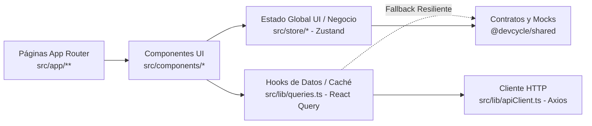
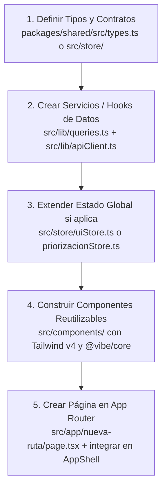

# Lineamientos de Desarrollo Frontend — DevCycle (El Puerto de Liverpool)

**Documento Oficial de Arquitectura, Estándares Técnicos y Convenciones de Código**  
**Proyecto:** DevCycle — Gestión Integral del Portafolio de Iniciativas (`apps/frontend`)  
**Organización:** El Puerto de Liverpool (Aplicación embebida en Monday.com Work OS)  
**Última actualización:** Noviembre 2026

---

## Tabla de Contenidos

1. [Introducción](#1-introducción)
2. [Principios de Arquitectura del Frontend](#2-principios-de-arquitectura-del-frontend)
3. [Stack Tecnológico](#3-stack-tecnológico)
4. [Estructura del Proyecto](#4-estructura-del-proyecto)
5. [Reglas Generales de Organización de Código](#5-reglas-generales-de-organización-de-código)
6. [Lineamientos de Desarrollo](#6-lineamientos-de-desarrollo)
7. [Cómo Crear un Nuevo Módulo o Funcionalidad](#7-cómo-crear-un-nuevo-módulo-o-funcionalidad)
8. [Performance y Optimización](#8-performance-y-optimización)
9. [Seguridad y Resiliencia](#9-seguridad-y-resiliencia)
10. [Definition of Done (DoD)](#10-definition-of-done-dod)
11. [Proceso de Trabajo (Git y Convenciones de Commits)](#11-proceso-de-trabajo-git-y-convenciones-de-commits)

---

## 1. INTRODUCCIÓN

### 1.1 Contexto de la Plataforma

**DevCycle** es la plataforma corporativa de **El Puerto de Liverpool**, diseñada para ejecutarse tanto de forma embebida dentro de **Monday.com Work OS** como en modo navegador independiente (*standalone*). Su propósito central es unificar, automatizar y gobernar de extremo a extremo el ciclo de vida del portafolio de iniciativas tecnológicas.

A través de una interfaz web interactiva, DevCycle permite a los distintos actores del ecosistema (Solicitantes de Negocio, Business Partners, Portfolio Managers, PMO, Líderes Técnicos, Arquitectos de Dominio y Directores) gestionar las iniciativas a lo largo de **4 etapas macro** (*1. Definición*, *2. Estimación*, *3. Ejecución* y *4. Cierre*), abarcando flujos críticos como:

- **Discovery & Intake (`/discovery`):** Registro asistido por Inteligencia Artificial (DataSwat AI) de requerimientos de negocio, casos de uso, sistemas impactados y cuantificación de beneficios.
- **Gestión, Priorización y Evaluación de Iniciativas (`/iniciativas`):** Alineación estratégica (Pirámide Corporativa y Pizza OKRs), validación de impacto tecnológico en Backlog TI, evaluación multicriterio ponderada (`/iniciativas/evaluacion`), dictamen formal (`/iniciativas/confirmacion`) y reordenamiento visual con control de desplazamientos.
- **Estimación Asistida con IA y Doble VoBo (`/estimacion`):** Dimensionamiento técnico conversacional (TPS, concurrencia, SLA), generación automática de Hoja de Costos (infraestructura en nube y horas de desarrollo) y flujo de aprobación simultánea de Líder Técnico y Arquitectura.
- **Supervisión Ejecutiva y Seguimiento (`/`, `/project/[id]`, `/team`):** Visión consolidada del portafolio por Cartera de Negocio (*Digital, Negocios Financieros, EPL / Logística, Operaciones TI, Comercial / Tiendas*), seguimiento de etapas y administración de perfiles y roles.

### 1.2 Objetivo del Documento

El presente documento define los **lineamientos técnicos, arquitectónicos y de programación** que deben seguirse de manera **obligatoria** para el diseño, implementación y mantenimiento del frontend de **DevCycle** (`apps/frontend`).

Estos lineamientos buscan garantizar:

- **Consistencia arquitectónica** dentro del monorepo (`apps/frontend` y `@devcycle/shared`).
- **Calidad, legibilidad y mantenibilidad** del código tanto para desarrolladores humanos como para agentes de Inteligencia Artificial.
- **Uso estandarizado del stack tecnológico** y del Sistema de Diseño oficial (`docs/GUIA_ESTILOS_SISTEMA_DISENO.md`).
- **Homogeneidad** en la construcción de páginas, componentes, stores, consumo de APIs y manejo de estados.

### 1.3 Alcance

Los lineamientos descritos en este documento aplican exclusivamente al desarrollo del **frontend de DevCycle (`apps/frontend`)** y a su integración con el paquete compartido de contratos y datos **`packages/shared` (`@devcycle/shared`)**.

Este documento cubre:

- Arquitectura y principios de diseño del frontend.
- Organización de carpetas y archivos dentro del monorepo.
- Estándares de desarrollo con React 19, Next.js 16 (App Router) y TypeScript.
- Estilizado con Tailwind CSS v4 (`@theme inline`) y componentes de `@vibe/core`.
- Manejo de estado global (Zustand) y estado de servidor (TanStack React Query).
- Consumo resiliente de APIs (Axios) e integración con el SDK de Monday.com.
- Seguridad, rendimiento, Definition of Done (DoD) y flujo de ramas/commits en Git.

> **Nota:** Los lineamientos específicos del backend en NestJS (`apps/backend`) se documentan por separado.

### 1.4 Responsabilidades del Equipo de Desarrollo y Agentes de IA

Todo desarrollador o agente de IA que implemente una nueva funcionalidad, ajuste visual o corrección en `apps/frontend` deberá apegarse estrictamente a este documento:

- Seguir los estándares técnicos, de arquitectura y de estilizado definidos aquí y en `docs/GUIA_ESTILOS_SISTEMA_DISENO.md`.
- Mantener consistencia con la estructura actual del proyecto sin introducir patrones paralelos.
- Garantizar que el código compile sin errores de TypeScript y pase las validaciones de linting antes de confirmar cambios.
- Consultar con el Líder Técnico Frontend en caso de dudas arquitectónicas o escenarios no contemplados.

### 1.5 Consideraciones sobre Código Existente

Algunas vistas o componentes heredados de las primeras iteraciones del prototipo pueden estar en proceso de consolidación (por ejemplo, flujos legacy detallados en `docs/FLUJOS_FRONTEND_DEVCYCLE.md`). En estos casos se aplican las siguientes directrices:

- La existencia de código legacy que aún no cumpla al 100% algún lineamiento **no debe tomarse como referencia** para nuevas funcionalidades.
- **Toda nueva funcionalidad (`feature`) o componente debe apegarse íntegramente a este documento.**
- No se deberán realizar refactorizaciones masivas ajenas a la tarea en curso sin autorización previa del responsable técnico del proyecto.

---

## 2. PRINCIPIOS DE ARQUITECTURA DEL FRONTEND



### 2.1 Separación de Responsabilidades

La aplicación mantiene una separación clara entre cuatro capas principales:

1. **Presentación y Vistas (`src/app/` y `src/components/`):** Renderizado visual, interacción del usuario y maquetación responsiva con Tailwind CSS v4 y `@vibe/core`.
2. **Estado Global y Lógica de Dominio en Cliente (`src/store/`):** Estado compartido entre vistas (usuario activo en simulación, iniciativas en priorización, evaluaciones y estado del chat/menú) gestionado con **Zustand**.
3. **Acceso a Datos y Sincronización con Backend (`src/lib/`):** Cliente HTTP centralizado (`apiClient.ts`), hooks de consulta/mutación con **TanStack React Query** (`queries.ts`), contexto de Monday (`mondayClient.ts`) y utilidades de formato (`format.ts`).
4. **Contratos y Catálogos Compartidos (`packages/shared`):** Tipos, interfaces y datos semilla compartidos entre frontend y backend mediante el paquete `@devcycle/shared`.

### 2.2 Modularidad

El código debe organizarse por responsabilidades claras y dominios funcionales del ciclo de vida de DevCycle (*Portafolio, Discovery, Iniciativas/Priorización, Estimación, Proyecto y Equipo*), evitando el acoplamiento innecesario entre vistas.

### 2.3 Reutilización de Componentes y Utilidades

Antes de crear un nuevo componente visual o función auxiliar, es obligatorio verificar si ya existe una solución reutilizable en:

- `src/components/` (p. ej. `BackButton`, `StatusPill`, `RoleTag`, `ApprovalGate`, `FileDropzone`, `UnderConstructionView`).
- `@vibe/core` (`Button`, `Dropdown`, `TextField`, `TextArea`, `Toggle`, `Avatar`, `Label`, `Icon`).
- `src/lib/format.ts` (`formatCurrency`, `formatDate`, `formatBytes`).
- `@devcycle/shared` (tipos de dominio y catálogos).

### 2.4 Consistencia en Patrones de Desarrollo

Todos los módulos deben respetar las mismas convenciones en cuanto a:

- Nombres de archivos, componentes, hooks y stores.
- Consumo de variables de color y tema mediante Tailwind CSS v4 (`@theme inline`).
- Manejo de estados de carga, error y resiliencia ante desconexión del backend.
- Tipado estricto en TypeScript.

### 2.5 Escalabilidad y Mantenibilidad

La arquitectura debe permitir agregar nuevas etapas o módulos al ciclo de vida sin romper las vistas existentes:

- Evitar componentes monolíticos difíciles de leer; extraer subcomponentes o funciones auxiliares cuando una vista crezca en complejidad.
- Priorizar soluciones declarativas, legibles y simples sobre abstracciones prematuras.

### 2.6 Evolución Controlada de la Arquitectura

Cualquier cambio estructural en las carpetas base del monorepo, configuración de Next.js, tokens globales de diseño o incorporación de dependencias deberá ser revisado y aprobado previamente por el responsable técnico del frontend.

---

## 3. STACK TECNOLÓGICO

Todos los desarrollos del frontend de DevCycle deben utilizar **exclusivamente** las tecnologías y versiones definidas en esta sección:

| Categoría | Tecnología / Paquete | Versión en Proyecto | Propósito Principal |
| :--- | :--- | :---: | :--- |
| **Framework Principal** | `next` (App Router) | `^16.3.4` | Enrutamiento basado en `src/app`, layouts anidados y compilación `standalone`. |
| **Librería UI Base** | `react` / `react-dom` | `^19.2.8` | Construcción de interfaz mediante componentes funcionales y Hooks. |
| **Lenguaje** | `typescript` | `^5.5.4` | Tipado estático estricto (`strict: true`). |
| **Gestor de Monorepo** | `pnpm` (Workspaces) | `9.15.9` (Node `>=20`) | Gestión de dependencias y enlace con `@devcycle/shared` (`workspace:*`). |
| **Estilos** | `tailwindcss` + `@tailwindcss/postcss` | `^4.3.3` | Framework principal de estilos utilitarios con configuración `@theme inline`. |
| **Sistema de Diseño / UI** | `@vibe/core` | `^4.5.30` | Componentes base compatibles con el ecosistema Monday.com Work OS. |
| **Iconografía** | `@vibe/icons` | `^4.1.0` | Catálogo oficial y exclusivo de íconos de la plataforma. |
| **Estado Global** | `zustand` | `^5.0.15` | Gestión de estado global de UI y flujos de negocio en cliente. |
| **Estado del Servidor** | `@tanstack/react-query` | `^5.102.8` | Caché, sincronización, consultas (`useQuery`) y mutaciones (`useMutation`). |
| **Cliente HTTP** | `axios` | `^1.20.0` | Peticiones REST hacia el backend con soporte de interceptores. |
| **Formularios** | `react-hook-form` | `^7.87.0` | Gestión performante de formularios dinámicos, validaciones y arreglos de campos. |
| **Integración Monday** | `monday-sdk-js` | `1.0.0-beta` | Lectura de contexto (usuario, cuenta, tema) cuando corre embebido en Monday.com. |
| **Drag & Drop** | `@atlaskit/pragmatic-drag-and-drop` | `^3.1.0` | Reordenamiento interactivo de filas y tableros de priorización. |
| **Notificaciones** | `react-hot-toast` | Estándar oficial | Visualización de notificaciones emergentes (éxito, error, advertencia, info). |

### 3.1 Framework Principal (Next.js App Router)

El frontend está construido sobre **React 19** y **Next.js 16** utilizando exclusivamente el **App Router** (`src/app/`).

- Cada carpeta dentro de `src/app/` que contenga un archivo `page.tsx` define una ruta de la aplicación.
- El archivo `next.config.mjs` configura `output: "standalone"` para empaquetado ligero en contenedores Docker y declara `transpilePackages: ["@vibe/core", "@vibe/icons", "@devcycle/shared"]`.

### 3.2 Lenguaje de Desarrollo (TypeScript)

El uso de **TypeScript** es obligatorio en todos los archivos del proyecto (`.ts` y `.tsx`). La configuración en `tsconfig.json` exige `strict: true` y `allowJs: false`.

**No está permitido:**

- Crear archivos en JavaScript puro (`.js` / `.jsx`) dentro de `src/`.
- Deshabilitar verificaciones con `@ts-ignore` o `@ts-nocheck`.
- Utilizar el tipo `any` sin una justificación técnica explícita (preferir tipos de `@devcycle/shared`, `unknown` o genéricos bien acotados).

### 3.3 Manejo de Estado

DevCycle separa estrictamente el estado según su origen y propósito:

#### 3.3.1 Estado Global de la Aplicación (Zustand)
Se utiliza **Zustand** (`src/store/`) para información compartida entre múltiples componentes o páginas, tales como:
- Usuario activo en modo simulación (`activeUserId`), título activo de navegación, estado del menú principal y del asistente Copilot (`uiStore.ts`).
- Estado compartido del flujo de iniciativas, evaluación estratégica (Pirámide y Pizza OKRs), validación de Backlog TI, orden de priorización y dimensionamiento técnico (`priorizacionStore.ts`).

#### 3.3.2 Estado de Datos Provenientes del Servidor (TanStack React Query)
Se utiliza **TanStack React Query** (`src/lib/queries.ts`) para gestionar todas las peticiones asíncronas hacia el backend:
- Manejo automático de caché (`queryKey`), tiempos de frescura (`staleTime`) e invalidación tras mutaciones (`invalidateQueries` / `setQueryData`).
- Control declarativo de estados `isLoading`, `isPending` e `isError`.

### 3.4 Estilos y Componentes de UI

#### 3.4.1 Framework de Estilos Principal (Tailwind CSS v4)
El proyecto utiliza **Tailwind CSS v4** como **única herramienta para la definición de estilos**.
- Las variables de identidad institucional (**El Puerto de Liverpool** + armonía **Monday.com**) se declaran en `src/app/globals.css` dentro de `:root` y se exponen a Tailwind mediante el bloque **`@theme inline`**.
- **Prohibido** escribir clases de CSS puro o usar `style={{ ... }}` en línea para colores o maquetación estática.
- Toda especificación cromática, tipográfica y de medidas debe consultar **`docs/GUIA_ESTILOS_SISTEMA_DISENO.md`**.

#### 3.4.2 Librería de Componentes (`@vibe/core`)
Se utiliza **`@vibe/core`** (Vibe Design System de Monday.com) para componentes interactivos base como `Button`, `Dropdown`, `TextField`, `TextArea`, `Toggle`, `Avatar`, `Label`, `Icon` y `ThemeProvider`, combinados con componentes propios de DevCycle estilizados con Tailwind CSS v4.

#### 3.4.3 Iconografía (`@vibe/icons`)
Para la iconografía de la plataforma se utilizan **exclusivamente** los íconos de **`@vibe/icons`** integrados mediante el componente `<Icon />` de `@vibe/core` (o SVGs inline puntuales propios del sistema de diseño cuando no exista equivalente). **No está permitido instalar librerías adicionales de íconos** (como `lucide-react`, `react-icons` o `@mui/icons-material`).

### 3.5 Manejo de Formularios

Para formularios complejos o dinámicos (como la captura de campos por etapa en `DynamicStageForm.tsx`) se utiliza **React Hook Form** (`useForm`, `Controller`, `useFieldArray`), minimizando re-renderizados y facilitando la integración con inputs de `@vibe/core`.

### 3.6 Consumo de APIs

El consumo de APIs se realiza mediante **Axios** a través de la instancia centralizada `apiClient` (`src/lib/apiClient.ts`), consumida desde los hooks de **React Query** en `src/lib/queries.ts`.

### 3.7 Sistema de Notificaciones (React Hot Toast)

Para la visualización de notificaciones emergentes (*toasts*) dentro de la interfaz de usuario se establece como estándar **React Hot Toast** (`react-hot-toast`). Se emplea para mostrar retroalimentación inmediata de éxito, error, advertencia o información en acciones como guardar formularios, formalizar prioridades, registrar VoBos o reportar fallos de red.

### 3.8 Linting y Verificación de Build

El proyecto valida la calidad del código mediante:
- `pnpm lint` (`next lint` en `apps/frontend`)
- `pnpm build` (compilación de `@devcycle/shared` + `next build` con verificación estricta de TypeScript)

No está permitido ignorar errores de linting ni romper el build de producción.

### 3.9 Infraestructura y Despliegue

El frontend se empaqueta mediante `apps/frontend/Dockerfile` (usando la salida `standalone` de Next.js en el puerto `3002`) y se despliega como servicio independiente en **Google Cloud Platform (Cloud Run)**.

### 3.10 Incorporación de Nuevas Librerías

Con el objetivo de mantener control sobre el tamaño del bundle y la arquitectura del monorepo, **no está permitido instalar nuevas librerías o dependencias en `apps/frontend` sin aprobación previa del responsable técnico.**

Cuando una nueva dependencia sea estrictamente necesaria, se deberá presentar una justificación técnica que incluya:
1. Descripción de la librería propuesta y problema específico que resuelve.
2. Comparación con al menos **dos alternativas adicionales**.
3. Nivel de adopción en la comunidad, mantenimiento reciente y compatibilidad con React 19 / Next.js 16.
4. Modelo de licencia (Open Source MIT/Apache 2.0) y análisis de riesgos de seguridad.

---

## 4. ESTRUCTURA DEL PROYECTO

DevCycle está organizado como un **monorepo con `pnpm workspaces`**. A nivel raíz, la estructura relevante para el desarrollo frontend es la siguiente:

```text
devcycle-back-front/
├── apps/
│   ├── backend/                 # API REST en NestJS (documentada por separado)
│   └── frontend/                # Aplicación Next.js 16 (App Router) + React 19
│       ├── public/              # Recursos estáticos públicos
│       ├── src/                 # Código fuente principal del frontend
│       │   ├── app/             # Rutas, layouts, estilos globales y providers
│       │   ├── components/      # Componentes de UI reutilizables y de dominio
│       │   ├── lib/             # Cliente Axios, React Query hooks, Monday SDK y utils
│       │   └── store/           # Stores globales de Zustand
│       ├── AGENTS.md            # Instrucciones locales para agentes de IA
│       ├── next.config.mjs      # Configuración de Next.js
│       ├── package.json         # Dependencias del workspace frontend
│       └── tsconfig.json        # Configuración TypeScript y alias @/*
├── packages/
│   └── shared/                  # Paquete compartido @devcycle/shared
│       └── src/
│           ├── index.ts         # Barril de exportación de tipos y datos
│           ├── types.ts         # Interfaces y tipos de dominio compartidos
│           ├── flows-data.ts    # Definición de las etapas y subpasos BPMN
│           ├── projects-data.ts # Datos semilla de proyectos
│           ├── roles-data.ts    # Catálogo de roles corporativos
│           └── users-data.ts    # Catálogo de usuarios de prueba / simulación
├── docs/                        # Documentación oficial de arquitectura, flujos y diseño
├── MEMORY.md                    # Memoria persistente de decisiones de arquitectura y estilos
└── package.json                 # Scripts globales del monorepo
```

### 4.1 Carpeta `apps/frontend/public`

Contiene únicamente recursos estáticos que deben servirse de forma directa desde la raíz del servidor web (como `favicon.ico` e `icon.png`). No se deben almacenar componentes ni íconos de interfaz en esta carpeta; la iconografía debe provenir de `@vibe/icons`.

### 4.2 Carpeta `apps/frontend/src`

Concentra todo el código fuente del frontend, dividido en cuatro directorios con responsabilidades bien delimitadas:

| Directorio | Responsabilidad |
| :--- | :--- |
| `src/app/` | Sistema de rutas del App Router de Next.js, layout raíz, proveedores de contexto y variables globales de tema (`globals.css`). |
| `src/components/` | Componentes visuales reutilizables, estructura base (`AppShell`) y componentes específicos de los flujos de negocio. |
| `src/lib/` | Comunicación HTTP (`apiClient.ts`), hooks de servidor con React Query (`queries.ts`), integración con Monday (`mondayClient.ts`) y formateadores (`format.ts`). |
| `src/store/` | Estado global compartido en cliente mediante Zustand (`uiStore.ts` y `priorizacionStore.ts`). |

### 4.3 Carpeta `src/app` (Rutas y Configuración Global)

Implementa el **App Router** de Next.js:

```text
src/app/
├── layout.tsx                   # RootLayout (HTML, fuentes Google Fonts: Montserrat/Figtree/Roboto, globals.css)
├── ClientProviders.tsx          # Cargador dinámico client-only (ssr: false) para evitar hydration mismatches de Vibe
├── providers.tsx                # QueryClientProvider (React Query) + ThemeProvider (@vibe/core) + AppShell
├── globals.css                  # Import de Tailwind v4, @vibe/core/tokens, variables :root y bloque @theme inline
├── not-found.tsx                # Vista personalizada para rutas inexistentes (404)
├── page.tsx                     # Home / Portafolio Ejecutivo (/)
├── discovery/
│   └── page.tsx                 # Módulo de Discovery & Intake asistido por IA (/discovery)
├── iniciativas/
│   ├── page.tsx                 # Tablero de Iniciativas, Backlog TI y Priorización (/iniciativas)
│   ├── evaluacion/
│   │   └── page.tsx             # Evaluación Multicriterio ponderada (/iniciativas/evaluacion)
│   └── confirmacion/
│       └── page.tsx             # Confirmación de dictamen y prioridad (/iniciativas/confirmacion)
├── estimacion/
│   └── page.tsx                 # Sizing con IA, Hoja de Costos y VoBo Dual (/estimacion)
├── project/
│   └── [id]/
│       └── page.tsx             # Ruta dinámica: Ficha / Detalle de Proyecto (/project/[id])
├── team/
│   └── page.tsx                 # Configuración y consulta de usuarios y roles (/team)
└── en-construccion/
    └── page.tsx                 # Vista fallback para módulos en construcción (/en-construccion)
```

#### 4.3.1 Arquitectura de Providers y Shell Global
- **`layout.tsx`:** Define la estructura HTML base (`lang="es"`), carga las tipografías corporativas (`Montserrat`, `Figtree`, `Roboto`) y envuelve el contenido en `<ClientProviders>`.
- **`ClientProviders.tsx`:** Carga `providers.tsx` con `dynamic(..., { ssr: false })`. Dado que los portales de `@vibe/core` (`Dropdown`, `Dialog`, `Tooltip`) generan marcado distinto entre servidor y cliente y la aplicación se ejecuta embebida en un iframe autenticado, este patrón evita errores de hidratación (*hydration mismatches*).
- **`providers.tsx`:** Inicializa el `QueryClient` de TanStack Query, el `ThemeProvider` de Vibe y envuelve todas las páginas dentro de **`<AppShell>`**, manteniendo persistentes el encabezado institucional, el selector de simulación de roles (`RoleSwitcher`), el menú desplegable (`MainMenuOverlay`) y el asistente lateral (`CopilotChat`).

### 4.4 Carpeta `src/components`

Contiene los componentes de interfaz de la aplicación. Cada componente se ubica como un archivo `.tsx` nombrado en **PascalCase**:

```text
src/components/
├── AppShell.tsx                 # Layout interactivo principal (Header, banner de simulación, MainMenuOverlay, CopilotChat)
├── MainMenuOverlay.tsx          # Menú de navegación principal desplegable
├── BackButton.tsx               # Botón estándar de retorno entre pantallas
├── StatusPill.tsx               # Badge semántico de estado operativo (Finalizado, En proceso, Atrasado, Por iniciar)
├── RoleTag.tsx                  # Etiqueta visual de rol corporativo basada en @vibe/core Label
├── RoleSwitcher.tsx             # Selector "Actuar como" para simulación de perfiles y permisos
├── CopilotChat.tsx              # Panel lateral del asistente inteligente de portafolio
├── DynamicStageForm.tsx         # Generador de formularios dinámicos con React Hook Form y @vibe/core
├── ApprovalGate.tsx             # Componente de control de aprobaciones por rol (gating)
├── StageTracker.tsx             # Visualizador de progreso de etapas macro
├── SubflowStepper.tsx           # Stepper interactivo de subpasos BPMN
├── FileDropzone.tsx             # Zona de carga de documentos drag-and-drop
└── UnderConstructionView.tsx    # Vista reutilizable para secciones en desarrollo
```

Se distinguen dos categorías de componentes:
1. **Componentes transversales / base:** Utilizados en múltiples páginas (`AppShell`, `BackButton`, `StatusPill`, `RoleTag`, `UnderConstructionView`).
2. **Componentes de módulo o flujo:** Encapsulan lógica visual de una funcionalidad específica (`DynamicStageForm`, `ApprovalGate`, `StageTracker`, `SubflowStepper`, `CopilotChat`).

### 4.5 Carpeta `src/lib`

Centraliza la comunicación externa, integración con SDKs y funciones utilitarias puras:

- **`apiClient.ts`:** Configura la instancia única de **Axios** (`baseURL` desde `NEXT_PUBLIC_API_URL`), headers JSON e interceptores de `request` (logging de diagnóstico en desarrollo) y `response` (normalización de mensajes de error).
- **`queries.ts`:** Contiene todos los custom hooks de **TanStack React Query** (`useFlows`, `useRoles`, `useUsers`, `useProjects`, `useProject`, `usePatchProject`, `useAddApproval`, `useAddFile`, `useSendChatMessage`).
- **`mondayClient.ts`:** Encapsula la instancia singleton de `monday-sdk-js` y expone el hook `useMondayContext()` con resolución asíncrona y *fallback* automático en 800ms cuando la app se ejecuta fuera de Monday.com.
- **`format.ts`:** Funciones utilitarias puras para formateo de moneda (`formatCurrency` en `es-MX` / `MXN`), fechas (`formatDate`) y tamaños de archivo (`formatBytes`).

### 4.6 Carpeta `src/store`

Contiene los stores globales implementados con **Zustand**:

- **`uiStore.ts` (`useUiStore`):** Estado global de la interfaz (usuario activo simulado `activeUserId`, etapa seleccionada `selectedStageId`, título del header `activeMenuTitle`, visibilidad de `MainMenuOverlay` y `CopilotChat`, e historial de mensajes del asistente).
- **`priorizacionStore.ts` (`usePriorizacionStore`):** Estado global del ciclo de vida de iniciativas (listado de iniciativas, registro desde Discovery, validación de Backlog TI, cálculo de puntos Pirámide y Pizza OKRs, evaluación multicriterio, reordenamiento de prioridades y datos de estimación técnica / VoBo dual).

### 4.7 Paquete Compartido `packages/shared` (`@devcycle/shared`)

En lugar de duplicar interfaces entre el frontend y el backend, los contratos de dominio comunes residen en `packages/shared/src/`:

- **`types.ts`:** Define tipos e interfaces como `ProjectStatus`, `MacroStage`, `StandardOperativeStatus`, `BusinessPortfolio`, `Priority`, `Stage`, `SubStep`, `FieldDef`, `Role`, `User`, `Approval`, `ProjectDocument`, `ChatMessage` y `Project`.
- **`*-data.ts`:** Exporta los datos semilla (`stages`, `projects`, `roles`, `users`) que sirven tanto al backend en memoria como al sistema de *fallback* resiliente del frontend.
- **`index.ts`:** Archivo de barril (`export * from ...`) que expone todo el contenido bajo el import `@devcycle/shared`.

---

## 5. REGLAS GENERALES DE ORGANIZACIÓN DE CÓDIGO

### 5.1 Separación de Responsabilidades y Flujo de Datos

Cada capa debe respetar estrictamente su responsabilidad dentro del flujo de la aplicación:

```text
Page (src/app) ➔ Component (src/components) ➔ Query Hook / Store (src/lib/queries | src/store) ➔ API Client (src/lib/apiClient)
```

- **Pages (`src/app/**/page.tsx`):** Se encargan de la composición de la pantalla, lectura de parámetros de ruta (`useParams`, `useSearchParams`) y coordinación de secciones.
- **Components (`src/components/*.tsx`):** Encapsulan la interfaz visual reutilizable y la interacción puntual del usuario.
- **Query Hooks (`src/lib/queries.ts`):** Encapsulan la obtención y mutación de datos del servidor con TanStack Query.
- **Stores (`src/store/*.ts`):** Gestionan el estado global compartido entre vistas con Zustand.
- **API Client (`src/lib/apiClient.ts`):** Es el **único** punto autorizado para ejecutar llamadas HTTP con Axios. **Las páginas y componentes nunca deben importar `axios` ni usar `fetch` directamente.**

### 5.2 Uso Correcto de Hooks

- Un hook **nunca debe retornar JSX o componentes de React**; su retorno debe ser únicamente datos, estados y funciones accionadoras.
- Un custom hook local **no debe usarse para compartir estado global entre componentes desconectados**. Para compartir estado entre componentes o páginas, se debe utilizar un store de **Zustand** en `src/store/`.

### 5.3 Centralización de Lógica según su Propósito

Toda pieza de código nueva debe ubicarse en el directorio que corresponde a su responsabilidad:

| Tipo de Lógica | Ubicación Obligatoria |
| :--- | :--- |
| Contratos, tipos e interfaces compartidas con Backend | `packages/shared/src/types.ts` (`@devcycle/shared`) |
| Tipos específicos del flujo de iniciativas en cliente | `apps/frontend/src/store/priorizacionStore.ts` |
| Instancia HTTP e interceptores de Axios | `apps/frontend/src/lib/apiClient.ts` |
| Hooks de lectura y escritura de APIs (React Query) | `apps/frontend/src/lib/queries.ts` |
| Integración con Monday SDK | `apps/frontend/src/lib/mondayClient.ts` |
| Funciones utilitarias y de formateo (`Intl`, fechas, moneda) | `apps/frontend/src/lib/format.ts` |
| Estado global compartido de UI o negocio | `apps/frontend/src/store/` |
| Componentes visuales reutilizables | `apps/frontend/src/components/` |
| Variables de color, tipografía y `@theme inline` | `apps/frontend/src/app/globals.css` |

### 5.4 Convenciones de Importación

- Utilizar siempre el alias **`@/`** configurado en `tsconfig.json` para importar módulos entre distintas carpetas de `src/`:
  ```tsx
  // ✅ Correcto
  import { useUiStore } from "@/store/uiStore";
  import { useProjects, usePatchProject } from "@/lib/queries";
  import { BackButton } from "@/components/BackButton";
  ```
- Importar contratos y datos compartidos directamente desde el barril de **`@devcycle/shared`**:
  ```tsx
  // ✅ Correcto
  import type { Project, Stage, User } from "@devcycle/shared";
  ```

---

## 6. LINEAMIENTOS DE DESARROLLO

### 6.1 Manejo de Llamadas a APIs (`src/lib/apiClient.ts`)

Todas las llamadas HTTP hacia el backend deben realizarse a través de la instancia `apiClient` configurada con Axios:

```ts
import axios from "axios";

export const API_BASE_URL = process.env.NEXT_PUBLIC_API_URL ?? "http://localhost:3001";

export const apiClient = axios.create({
  baseURL: API_BASE_URL,
  headers: { "Content-Type": "application/json" },
});
```

- **Prohibido** instanciar `axios.create` o llamar a `fetch()` directamente dentro de componentes o páginas.
- Los interceptores de `apiClient` centralizan la normalización de errores y el envío de cabeceras comunes.

### 6.2 Uso de TanStack React Query (`src/lib/queries.ts`)

Toda lectura (`GET`) o escritura (`POST`, `PATCH`, `PUT`, `DELETE`) hacia el backend debe encapsularse en hooks dentro de `src/lib/queries.ts`:

```tsx
export function useProjects() {
  return useQuery({
    queryKey: ["projects"],
    queryFn: async () => {
      try {
        return (await apiClient.get<Project[]>("/projects")).data;
      } catch {
        return mockProjects;
      }
    },
  });
}

export function usePatchProject() {
  const queryClient = useQueryClient();
  return useMutation({
    mutationFn: async ({ id, ...body }: PatchProjectInput) =>
      (await apiClient.patch<Project>(`/projects/${id}`, body)).data,
    onSuccess: (project) => {
      queryClient.setQueryData(["projects", project.id], project);
      queryClient.invalidateQueries({ queryKey: ["projects"] });
    },
  });
}
```

- Utilizar `queryKey` descriptivos y jerárquicos (p. ej. `["projects"]` para listas y `["projects", id]` para detalle).
- Definir `staleTime: Infinity` en catálogos estáticos (`flows`, `roles`, `users`) para evitar peticiones redundantes.
- En cada `useMutation`, actualizar o invalidar las entradas de caché afectadas dentro de `onSuccess`.

### 6.3 Uso de Zustand para Estado Global (`src/store/`)

Los stores de Zustand deben seguir estas reglas:

- Seleccionar únicamente la porción de estado necesaria en cada componente mediante **selectores atómicos** para evitar re-renderizados innecesarios:
  ```tsx
  // ✅ Correcto: selector atómico
  const activeUserId = useUiStore((s) => s.activeUserId);
  const toggleChat = useUiStore((s) => s.toggleChat);

  // ❌ Incorrecto: suscribirse a todo el store sin selector
  const uiStore = useUiStore();
  ```
- No utilizar el store global para estados efímeros que pertenecen a un único componente (como el texto temporal de un input de búsqueda local o la apertura de un dropdown local).

### 6.4 Uso Responsable de `useState` y `useEffect`

Antes de declarar un `useState` o `useEffect`, el desarrollador debe verificar si el valor puede obtenerse mediante:

1. **Cálculos derivados en el render** (o `useMemo` si el cálculo es costoso):
   ```tsx
   // ✅ Correcto: dato derivado sin useEffect ni useState extra
   const activeUser = users.find((u) => u.id === activeUserId);
   const activeRole = roles.find((r) => r.id === activeUser?.roleId);
   ```
2. **TanStack React Query** (para datos asíncronos).
3. **Zustand** (para estado compartido entre pantallas).

El abuso de `useEffect` para sincronizar estados locales provoca renders en cascada, bugs difíciles de rastrear y degradación de rendimiento.

### 6.5 Manejo de Errores y Sistema de Notificaciones (`react-hot-toast`)

- Los errores técnicos en capas de servicios o mutaciones deben registrarse con `console.error` incluyendo contexto útil para diagnóstico.
- Cuando una acción del usuario (guardar iniciativa, formalizar priorización, otorgar VoBo, cargar archivo) tenga éxito o falle, se debe notificar visualmente al usuario utilizando **React Hot Toast** (`toast.success`, `toast.error`) o los banners/modales de confirmación del sistema de diseño.
- Es responsabilidad del desarrollador distinguir cuándo un error requiere retroalimentación inmediata al usuario (mutaciones y envíos de formulario) y cuándo debe operar un *fallback* silencioso (lectura inicial en modo demo offline).

### 6.6 Componentes Funcionales de React

Todos los componentes deben implementarse como **Functional Components** tipados con TypeScript. Queda prohibido el uso de *Class Components*.

### 6.7 Uso de Client Components (`"use client"`)

Dado que DevCycle es una aplicación altamente interactiva embebida en Monday.com que utiliza hooks de React, Zustand, React Query y componentes con portales de `@vibe/core`:

- Todo componente o página que utilice hooks (`useState`, `useEffect`, `useMemo`, `useRouter`, `usePathname`, `useQuery`, `useUiStore`) o manejadores de eventos interactivos debe declarar explícitamente la directiva en la primera línea del archivo:
  ```tsx
  "use client";
  ```

### 6.8 Convenciones de Nomenclatura de Archivos

Se deben respetar estrictamente las siguientes convenciones de nombres:

| Tipo de Archivo | Ubicación | Convención de Nombre | Ejemplo Real en DevCycle |
| :--- | :--- | :--- | :--- |
| **Páginas de Ruta** | `src/app/<ruta>/` | `page.tsx` (carpeta en `kebab-case`) | `src/app/en-construccion/page.tsx` |
| **Layouts** | `src/app/` | `layout.tsx` | `src/app/layout.tsx` |
| **Componentes UI** | `src/components/` | `PascalCase.tsx` | `src/components/DynamicStageForm.tsx` |
| **Stores de Zustand** | `src/store/` | `camelCaseStore.ts` (hook exportado `useNombreStore`) | `src/store/priorizacionStore.ts` |
| **Hooks de React Query** | `src/lib/queries.ts` | Función exportada `useNombreRecurso` en `camelCase` | `useProjects()`, `usePatchProject()` |
| **Clientes y Utilidades** | `src/lib/` | `camelCase.ts` | `src/lib/apiClient.ts`, `src/lib/format.ts` |
| **Tipos Compartidos** | `packages/shared/src/` | `PascalCase` para `interface` y `type` en `types.ts` | `Project`, `MacroStage`, `BusinessPortfolio` |

### 6.9 Manejo de Formularios

- **Formularios dinámicos o complejos** (múltiples campos, validaciones, tablas editables): Implementar obligatoriamente con **React Hook Form** (`useForm`, `Controller`, `useFieldArray`) siguiendo el patrón de `DynamicStageForm.tsx`.
- **Controles aislados o filtros rápidos** (buscadores por texto, selectores de cartera, sliders de evaluación interactiva): Pueden implementarse mediante inputs controlados con `useState` o conectados al store correspondiente.

### 6.10 Navegación entre Páginas

Toda navegación programática o declarativa debe utilizar las utilidades nativas del App Router de Next.js (`next/navigation` y `next/link`):

```tsx
import { useRouter, usePathname } from "next/navigation";
import Link from "next/link";
```

- Para botones de regreso entre pantallas de un flujo, utilizar el componente estándar **`<BackButton />`** (`src/components/BackButton.tsx`), especificando `fallbackHref` hacia la ruta padre correspondiente.
- Al agregar una nueva ruta principal, asegurar su sincronización con el título del encabezado en `AppShell.tsx` y su entrada en `MainMenuOverlay.tsx`.

### 6.11 Contexto de Monday.com, Autenticación y Simulación de Roles

DevCycle opera bajo un esquema dual de identidad y contexto:

1. **Contexto Embebido en Monday.com (`src/lib/mondayClient.ts`):**
   - El hook `useMondayContext()` consulta el contexto del host mediante `monday.get("context")`.
   - Si la aplicación se ejecuta fuera de Monday.com (en navegador local o demo directa), tras un *timeout* no bloqueante de **800ms** resuelve automáticamente a un contexto mock (`MOCK_CONTEXT`), garantizando que la interfaz nunca se quede congelada esperando al iframe padre.
2. **Simulación de Roles y Gating (`RoleSwitcher` y `ApprovalGate`):**
   - El encabezado global en `AppShell.tsx` incluye el selector **"Probar como…"** (`RoleSwitcher.tsx`), que actualiza `activeUserId` en `useUiStore`.
   - Cuando el usuario activo es distinto al usuario raíz (`u-01`), `AppShell` despliega automáticamente el banner institucional de **MODO PRUEBAS** indicando el usuario y rol simulado.
   - Los pasos de aprobación (`type === "approval"`) validan el rol requerido (`approverRoleId`) contra el rol del usuario activo antes de habilitar las acciones de aprobación o rechazo.
3. **Autenticación hacia el Backend (BFF Gateway):**
   - Cualquier token de sesión o cabecera de identidad debe inyectarse de forma centralizada en los interceptores de `src/lib/apiClient.ts`, nunca de forma manual en cada llamada de componente.

### 6.12 Manejo Resiliente de Peticiones a APIs

Las funcionalidades del frontend deben ser **100% resilientes**: una caída o demora del backend **nunca debe bloquear la pantalla ni romper la experiencia del usuario**.

- En las consultas de lectura (`src/lib/queries.ts`), se utiliza el bloque `try / catch` retornando como *fallback* los catálogos de `@devcycle/shared` (`mockStages`, `mockRoles`, `mockUsers`, `mockProjects`) cuando el servicio no esté disponible.
- En páginas con rutas dinámicas o parámetros de búsqueda (como `/project/[id]` o `/iniciativas/evaluacion?id=...`), siempre se debe manejar el escenario en que el identificador no exista mostrando un estado informativo claro y un botón para regresar al tablero principal.

### 6.13 Estados de Carga y Estabilidad Visual

Todo componente que dependa de operaciones asíncronas debe contemplar explícitamente los tres estados de interfaz:

1. **Loading / Pending:** Mostrar indicadores de carga (`loading={mutation.isPending}` en `<Button />`, skeletons o estados de carga con las mismas dimensiones del contenido final para evitar saltos de layout / *Cumulative Layout Shift*).
2. **Error:** Mostrar retroalimentación clara sin bloquear la navegación del usuario.
3. **Data (Success):** Renderizar la información de forma progresiva tan pronto como cada bloque esté disponible.

### 6.14 Uso Obligatorio de Componentes Base y Sistema de Diseño

Para preservar la identidad visual de **El Puerto de Liverpool + Monday.com**, es obligatorio:

- Consultar y respetar la **`docs/GUIA_ESTILOS_SISTEMA_DISENO.md`** para tipografía (`Montserrat`), jerarquía de pesos (`--font-weight-bold: 700`), paleta de colores institucionales (`#833177`, `#e6007e`, `#b52670`), colores semánticos por situación (`info`, `success`, `warning`, `danger`) y estados de botones (`default`, `hover`, `active`, `disabled`).
- Reutilizar los componentes base del proyecto (`AppShell`, `BackButton`, `StatusPill`, `RoleTag`, `UnderConstructionView`) y los controles de `@vibe/core` en lugar de reimplementar controles equivalentes desde cero.

### 6.15 Uso Exclusivo de Tailwind CSS v4 y `@theme inline`

Tal como se establece en `MEMORY.md`:

1. **Cero CSS puro ni estilos inline:** Todo el estilizado debe realizarse con clases utilitarias de **Tailwind CSS v4**, incluyendo pseudoclases (`hover:`, `focus:`, `active:`, `disabled:`) y breakpoints responsivos (`sm:`, `md:`, `lg:`, `xl:`). No se permite agregar clases CSS manuales ni usar `style={{ ... }}` para diseño o colores estáticos.
2. **Variables globales en `src/app/globals.css` + `@theme inline`:**
   - El archivo `globals.css` se mantiene exclusivamente para importar `@import "tailwindcss";` y `@import "@vibe/core/tokens";`, declarar las variables en `:root` y exponerlas a Tailwind dentro del bloque `@theme inline`.
   - Toda variable registrada en `@theme inline` como `--color-<nombre>` debe consumirse en JSX mediante las clases nativas generadas por Tailwind:

```tsx
// ✅ Correcto: Uso de utilidades semánticas registradas en @theme inline
<button
  type="button"
  className="rounded-lg bg-brand-primary px-4 py-2 text-xs font-bold text-white transition-colors hover:bg-brand-primary-hover active:bg-brand-primary-active disabled:opacity-50"
>
  Confirmar Iniciativa
</button>

<span className="border border-status-green-border bg-status-green-bg text-status-green-text">
  Finalizado
</span>

// ❌ Incorrecto: Estilos inline o colores arbitrarios fuera del sistema de diseño
<button style={{ backgroundColor: "#833177", color: "white" }}>
  Confirmar Iniciativa
</button>
```

### 6.16 Responsividad y Accesibilidad en Toda Resolución

Todas las páginas, tablas, formularios, encabezados y modales deben ser **100% responsivos** y accesibles en cualquier resolución de pantalla (tanto en monitores de escritorio como dentro del ancho reducido del iframe de Monday.com y dispositivos móviles):

- Utilizar los breakpoints de Tailwind (`sm:`, `md:`, `lg:`, `xl:`), contenedores flexibles (`flex-wrap`, `min-w-0`) y grillas adaptativas (`grid-cols-1 md:grid-cols-2 lg:grid-cols-4`).
- En tablas densas de portafolio o priorización, envolver en contenedores con `overflow-x-auto` para garantizar que ninguna columna o botón de acción quede inaccesible fuera del viewport.
- Incluir atributos `aria-label`, `title` y `type="button"` en todos los botones de acción e íconos interactivos.

---

## 7. CÓMO CREAR UN NUEVO MÓDULO O FUNCIONALIDAD

Cuando se desarrolle una nueva funcionalidad o pantalla en el frontend de DevCycle, se debe seguir este flujo ordenado de 5 pasos:



### 7.1 Paso 1: Definir Tipos e Interfaces
- Si los datos provienen o se envían al backend, agregar las interfaces en `packages/shared/src/types.ts` (y compilar el paquete compartido con `pnpm --filter @devcycle/shared build`).
- Si son tipos exclusivos de un store de cliente, declararlos y exportarlos en el archivo correspondiente dentro de `src/store/`.

### 7.2 Paso 2: Crear Hooks de Datos en `src/lib/queries.ts`
- Implementar las funciones `useQuery` o `useMutation` en `src/lib/queries.ts` consumiendo `apiClient` desde `src/lib/apiClient.ts`.
- Incluir manejo de errores y datos de respaldo (*fallback*) cuando corresponda para preservar la resiliencia de la aplicación.

### 7.3 Paso 3: Configurar Estado Global en `src/store/` (Opcional)
- Si la funcionalidad requiere compartir estado entre varias rutas (por ejemplo, pasar resultados de una etapa a otra), extender `priorizacionStore.ts`, `uiStore.ts` o crear un nuevo archivo `nombreStore.ts` en `src/store/` utilizando Zustand.

### 7.4 Paso 4: Construir Componentes en `src/components/`
- Crear los componentes necesarios en `src/components/NombreComponente.tsx`.
- Aplicar estrictamente las clases de Tailwind CSS v4 mapeadas en `@theme inline` y las medidas/colores de `docs/GUIA_ESTILOS_SISTEMA_DISENO.md`.

### 7.5 Paso 5: Crear la Página en `src/app/` e Integrar Navegación
- Crear `src/app/<nombre-modulo>/page.tsx` con `"use client";` si requiere interactividad.
- Actualizar el mapeo de títulos por ruta en `src/components/AppShell.tsx` y, si corresponde, agregar el acceso en `src/components/MainMenuOverlay.tsx`.

---

## 8. PERFORMANCE Y OPTIMIZACIÓN

Durante el desarrollo de nuevas funcionalidades se deben aplicar las siguientes prácticas para garantizar fluidez:

1. **Carga Progresiva de Datos:** Renderizar cada sección o tarjeta de una vista tan pronto como sus datos estén disponibles, sin bloquear toda la pantalla por una petición secundaria.
2. **Aprovechamiento del Caché de React Query:** Reutilizar `queryKey` consistentes (`["projects"]`, `["flows"]`, `["users"]`, `["roles"]`) para servir datos instantáneamente desde memoria cuando el usuario navega entre páginas.
3. **Selectores Atómicos en Zustand:** Suscribir cada componente únicamente a las propiedades que utiliza (`useUiStore((s) => s.isChatOpen)`) para evitar que cambios en otras propiedades disparen re-renderizados globales.
4. **Memoización Consciente (`useMemo`):** Utilizar `useMemo` únicamente para transformaciones, filtrados multicriterio o cálculos de matrices costosos sobre listas de iniciativas, evitando recalcular en cada pulsación de tecla.
5. **Componentes Ligeros y Modulares:** Dividir vistas extensas en subcomponentes cohesivos para aislar el alcance de los re-renderizados de estado local.

---

## 9. SEGURIDAD Y RESILIENCIA

Aunque las reglas de negocio críticas y la persistencia se validan en el backend, el frontend debe cumplir con los siguientes controles de seguridad:

### 9.1 Gestión Centralizada de Autenticación y Contexto
- Las cabeceras de autenticación y contexto hacia el backend se gestionan exclusivamente mediante interceptores en `src/lib/apiClient.ts`.
- La simulación de perfiles (`RoleSwitcher`) en el frontend es una herramienta visual y de validación funcional; en entornos productivos la autorización efectiva siempre es validada por el BFF / Backend.

### 9.2 Uso Obligatorio de Variables de Entorno
- Toda URL de servicio externo o configuración dependiente del entorno debe declararse mediante variables con el prefijo **`NEXT_PUBLIC_`** (por ejemplo `NEXT_PUBLIC_API_URL`), documentadas en `apps/frontend/.env.example`.
- **Prohibido** escribir URLs productivas o credenciales directamente (*hardcoded*) dentro de los componentes.

### 9.3 No Exponer Información Sensible
El código del frontend se descarga y ejecuta en el navegador del usuario. Por ningún motivo debe contener ni almacenar en el repositorio:
- Claves privadas de APIs (Gemini / Vertex AI, Jira, Monday API tokens privados).
- Credenciales de bases de datos o secretos de GCP.
- Archivos `.env` o `.env.local` (deben permanecer excluidos en `.gitignore`).

### 9.4 Manejo Responsable de Logs en Consola
- **Queda estrictamente prohibido dejar `console.log`, `console.debug` o `console.warn` en el código entregado** (con la única excepción del interceptor de desarrollo en `apiClient.ts` protegido por `process.env.NODE_ENV !== "production"`).
- Solo se permite el uso de `console.error` para diagnóstico de fallos inesperados, cuidando de **nunca imprimir tokens, credenciales ni datos personales sensibles**.

### 9.5 Validación Defensiva de Datos
- Nunca asumir que una respuesta de API o un parámetro de URL siempre vendrá completo: utilizar encadenamiento opcional (`?.`), valores por defecto (`??`) y funciones de formateo seguras (`formatCurrency`, `formatDate` de `src/lib/format.ts` que manejan `undefined`/`null` retornando `"—"`).

---

## 10. DEFINITION OF DONE (DoD)

Ninguna tarea, historia de usuario o nueva funcionalidad del frontend se considera terminada hasta cumplir **todos** los criterios de esta lista de verificación. Si alguno falla, el Pull Request no debe abrirse ni aprobarse:

- [ ] **10.1 Cumplimiento Funcional y de Diseño:** La funcionalidad cumple al 100% con los requerimientos de negocio, contempla estados de carga, vacío y error, es completamente responsiva y respeta la paleta, tipografía y medidas de `docs/GUIA_ESTILOS_SISTEMA_DISENO.md`.
- [ ] **10.2 Compilación Exitosa (`pnpm build`):** El proyecto compila sin errores de TypeScript ni de Next.js ejecutando `pnpm build` desde la raíz del monorepo (o `pnpm --filter @devcycle/shared build && pnpm --filter frontend build`).
- [ ] **10.3 Cero Errores de Lint (`pnpm lint`):** El código pasa todas las reglas de linting ejecutando `pnpm lint` (o `pnpm --filter frontend lint`).
- [ ] **10.4 Sin `console.log` Residuales:** Se eliminaron todos los `console.log`, `console.debug` y código comentado de depuración antes de realizar el commit.
- [ ] **10.5 Apego Estricto a Lineamientos:** Se utilizó exclusivamente Tailwind CSS v4 con variables de `@theme inline` (cero CSS puro o estilos inline estáticos), se respetó la separación de capas (`app` → `components` → `lib/store`) y se reutilizaron los componentes base.
- [ ] **10.6 Pruebas Manuales Completas:** Se verificó manualmente el flujo principal, la responsividad en distintos anchos de pantalla y el comportamiento al cambiar de rol en el simulador del encabezado.
- [ ] **10.7 Descripción Clara en el Pull Request:** El PR explica qué problema resuelve, qué archivos o módulos se modificaron y los pasos concretos para validar la funcionalidad.

---

## 11. PROCESO DE TRABAJO (GIT Y CONVENCIONES DE COMMITS)

### 11.1 Regla Obligatoria de Creación de Ramas

Cada nueva funcionalidad (`feature`), mejora o corrección debe trabajarse siempre en una rama independiente.

> **Regla de Oro:** Cada nueva feature se debe trabajar **siempre** en una nueva rama con el formato `feature/nombre-feature` (o `fix/nombre-fix` para correcciones de errores), y **esta nueva rama siempre deberá nacer de la rama `main` debidamente actualizada**.

Antes de comenzar cualquier desarrollo, el flujo obligatorio en terminal es el siguiente:

```bash
# 1. Posicionarse en la rama principal main
git checkout main

# 2. Actualizar main con los últimos cambios del repositorio remoto
git pull origin main

# 3. Crear y cambiar a la nueva rama de la funcionalidad en kebab-case
git checkout -b feature/nombre-de-la-funcionalidad
```

**Consideraciones adicionales sobre ramas:**
- **Nunca desarrollar directamente sobre `main`**.
- Los nombres de las ramas deben escribirse en **`kebab-case`** (minúsculas separadas por guiones), ser cortos y describir claramente el objetivo del cambio:
  - `feature/add-toast-notifications`
  - `feature/charter-summary-modal`
  - `fix/priorizacion-table-overflow`
- Si durante el desarrollo la rama `main` recibe actualizaciones de otros miembros del equipo, se debe mantener sincronizada la rama de trabajo para evitar conflictos al momento de integrar.

### 11.2 Convención de Mensajes de Commit

Durante el desarrollo se deben realizar commits pequeños, atómicos y descriptivos siguiendo la especificación de **Conventional Commits**.

Cada mensaje de commit debe iniciar con un prefijo válido seguido de una descripción breve y clara:

```text
<prefijo>(<alcance opcional>): <descripción breve del cambio>
```

**Ejemplos válidos:**
```text
feat(frontend): add multi-criteria evaluation confirmation view
fix(frontend): prevent layout shift in portfolio KPI cards
refactor(frontend): migrate stage components to Tailwind CSS v4 tokens
docs(frontend): add official frontend development guidelines
chore(frontend): update shared workspace types
```

**Evitar mensajes genéricos o ambiguos como:**
```text
fix stuff
changes
update
wip
```

#### Prefijos Permitidos

| Prefijo | Uso Correspondiente |
| :--- | :--- |
| **`feat:`** | Nueva característica o funcionalidad visible para el usuario. |
| **`fix:`** | Corrección de un bug o comportamiento inesperado. |
| **`docs:`** | Cambios exclusivamente en archivos de documentación (`docs/`, `README.md`, `MEMORY.md`, `AGENTS.md`). |
| **`style:`** | Ajustes de formato o estilos visuales que no alteran la lógica de negocio. |
| **`refactor:`** | Refactorización de código que no corrige un bug ni agrega una funcionalidad nueva. |
| **`perf:`** | Cambios enfocados en mejorar el rendimiento o reducir re-renderizados. |
| **`test:`** | Adición o ajuste de pruebas. |
| **`build:`** | Cambios que afectan el sistema de build, Dockerfiles o dependencias (`package.json`, `pnpm-lock.yaml`). |
| **`ci:`** | Cambios en pipelines o configuraciones de integración continua. |
| **`chore:`** | Tareas rutinarias de mantenimiento o configuración del repositorio. |
| **`revert:`** | Reversión de un commit previo. |

---

## CONFIDENCIALIDAD

Este documento contiene lineamientos internos, decisiones de arquitectura y estándares técnicos correspondientes a la plataforma **DevCycle** de **El Puerto de Liverpool**. Su contenido es **confidencial y de uso exclusivo del equipo de ingeniería, arquitectura, agentes autorizados y áreas involucradas en el proyecto**. Queda prohibida su distribución o reproducción externa sin autorización previa de los responsables de la plataforma.
